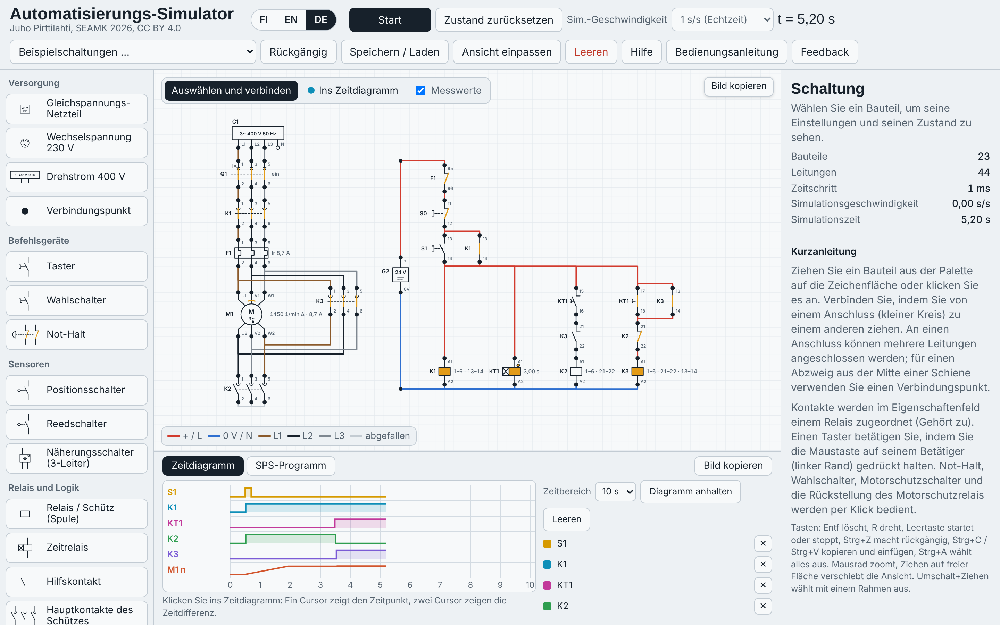
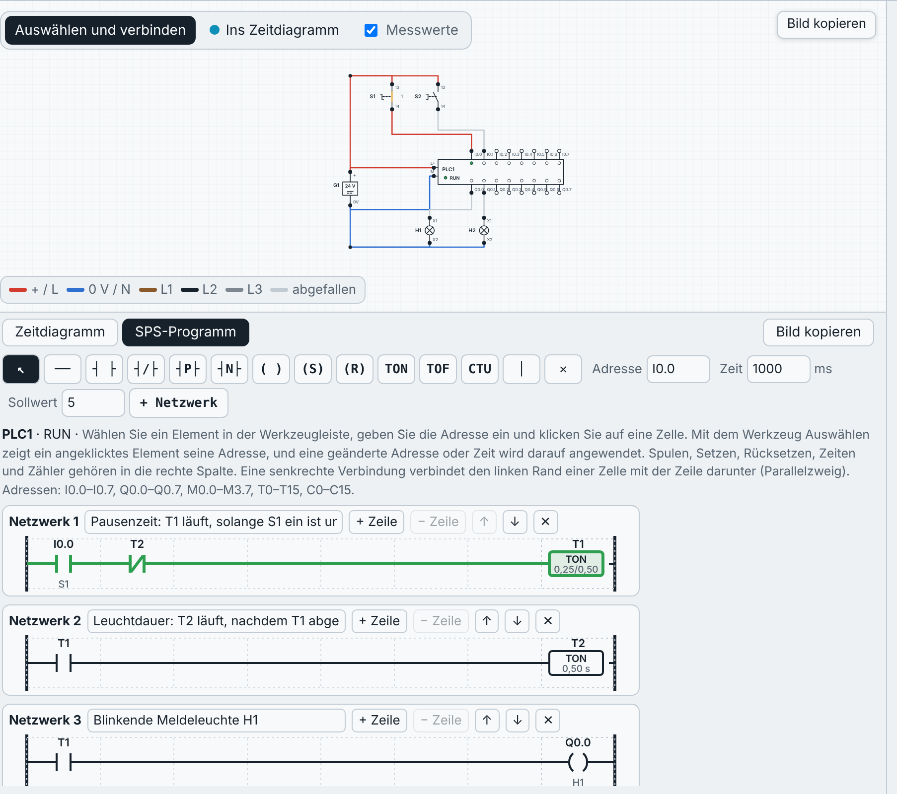
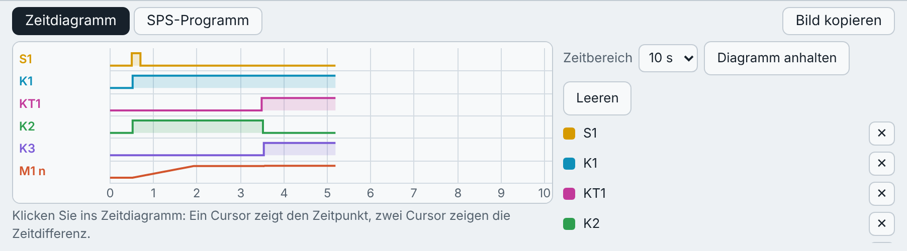

# Automatisierungs-Simulator – Bedienungsanleitung

> Diese Datei ist die versionierte Kopie der Bedienungsanleitung. Als Webseite: <https://jipirtti.github.io/Automaatiosimulaattori/docs/bedienungsanleitung.html>

Juho Pirttilahti, Fachhochschule Seinäjoki (SEAMK), 2026. Konzeption, Inhalt und Validierung: Juho Pirttilahti. Der Programmcode wurde KI-gestützt erstellt (Claude, Anthropic). Lizenz CC BY 4.0.

## Was der Simulator ist

Der Automatisierungs-Simulator ist ein browserbasiertes Lehrmittel für Relaissteuerungen, Steuerstromkreise und SPS-Programmierung. Eine Schaltung wird wie ein Stromlaufplan gezeichnet und funktioniert sofort nach dem Zeichnen:

- Taster werden mit der Maus betätigt
- Relais ziehen verzögert an
- Zylinder bewegen sich und betätigen Sensoren
- Motoren laufen an
- Schutzgeräte lösen aus

Das Zeitdiagramm zeigt die Zustandsänderungen über der Zeit; mit seinen Cursorn werden Zeiten gemessen. Die SPS wird im Kontaktplan (KOP, engl. LD) programmiert, und der Programmzustand wird während des Betriebs angezeigt.

Öffnen Sie den Simulator unter <https://jipirtti.github.io/Automaatiosimulaattori/?lang=de>. Eine Installation ist nicht nötig. Der Simulator funktioniert auch ohne Netzverbindung, wenn die Datei `index.html` direkt im Browser geöffnet wird.

Der Simulator dient dem Verständnis der Funktionsweise von Steuerstromkreisen. Mit ihm lassen sich keine realen Sicherheitsfunktionen auslegen und auch nicht deren Performance Level (PL) nachweisen (siehe Grenzen des Modells).

## Aufbau der Ansicht

| Bereich | Inhalt |
| --- | --- |
| Kopfzeile | Sprache (FI, EN, DE), Start/Pause, Zustand zurücksetzen, Simulationsgeschwindigkeit, Zeit, Beispielschaltungen, Rückgängig, Speichern / Laden, Ansicht einpassen, Leeren, Hilfe, Bedienungsanleitung, Feedback |
| Palette (links) | Bauteile nach Gruppen: Versorgung, Befehlsgeräte, Sensoren, Relais und Logik, Schutzgeräte, Aktoren |
| Zeichenfläche (Mitte) | Schaltung, Werkzeugleiste (Auswählen und verbinden, Ins Zeitdiagramm, Messwerte), Legende der Leitungsfarben und Warnungen |
| Eigenschaftenfeld (rechts) | Kennzeichen, Bedienung, Einstellungen und Zustand des gewählten Bauteils |
| Unterer Bereich | Registerkarten *Zeitdiagramm* (bis zu acht Signale, Zeitbereich, Cursor) und *SPS-Programm* (Kontaktplan-Editor) |

Die Farbe einer Leitung zeigt ihre Spannung:

| Farbe | Bedeutung |
| --- | --- |
| Rot | + oder L der Steuerspannung. Die Kanäle S11–S12, S21–S22 und der Reset-Kreis S33–S34 des Sicherheitsschaltgeräts erscheinen rot, wenn das Gerät versorgt ist. |
| Blau | 0 V oder N |
| Braun, Schwarz, Grau | L1, L2, L3 (IEC 60445) |
| Hell und dünn | Spannungslose oder nicht verbundene Leitung |

Den Zustand einer Leitung sehen Sie auch, wenn Sie mit der Maus darüberfahren.

## Schaltung aufbauen

### Bauteile, Leitungen und Schienen

- Ziehen Sie ein Bauteil aus der Palette auf die Zeichenfläche oder klicken Sie es an. Verschieben durch Ziehen, Drehen mit der Taste R, Löschen mit der Taste Entf.
- Eine Leitung verbinden Sie, indem Sie von einem Anschluss (kleiner Kreis) zu einem anderen ziehen. An einen Anschluss können mehrere Leitungen angeschlossen werden.
- Ein Steuerstromkreis wird als senkrechte Strompfade zwischen der +24-V- und der 0-V-Schiene gezeichnet. Eine Schiene entsteht, indem Sie einen **Verbindungspunkt** an einen Pol des Netzteils anschließen und von dort Leitungen zu den oberen bzw. unteren Enden der Strompfade ziehen. Die Beispielschaltungen sind so gezeichnet.
- Den Verlauf einer Leitung ändern Sie, indem Sie einen Abschnitt ziehen. Ein Doppelklick stellt den automatischen Verlauf wieder her.
- Mehrere Bauteile wählen Sie mit Umschalt+Ziehen oder Umschalt+Klick aus. Strg+C und Strg+V kopieren und fügen ein.

### Spule und Kontakte

Wie im Stromlaufplan sind die Spule eines Relais und seine Kontakte getrennte Bauteile:

1. Fügen Sie ein **Relais / Schütz (Spule)** hinzu. Sein Kennzeichen (zum Beispiel K1) steht neben der Spule. Das Kennzeichen kann im Eigenschaftenfeld geändert werden.
2. Fügen Sie einen **Hilfskontakt** hinzu und wählen Sie im Eigenschaftenfeld *Gehört zu*: K1. Ein neuer Kontakt wird standardmäßig dem zuletzt hinzugefügten Relais zugeordnet.
3. Wählen Sie *Kontakt*: Schließer (NO) oder Öffner (NC), und die Ordnungsziffer (1. Ziffer).
4. Die dreipoligen **Hauptkontakte** eines Schützes (1–2, 3–4, 5–6) werden als eigenes Bauteil hinzugefügt und auf dieselbe Weise dem Schütz zugeordnet.

Neben der Spule steht die Liste ihrer Kontakte (Kontaktspiegel), zum Beispiel *1–6 · 13–14 · 21–22*. Wird das Kennzeichen eines Relais geändert, folgen ihm seine Kontakte.

| Gerät | Schließer (NO) | Öffner (NC) |
| --- | --- | --- |
| Relais, Schütz, Motorschutzschalter | n3–n4 (13–14, 23–24 …) | n1–n2 (11–12, 21–22 …) |
| Zeitrelais | n7–n8 (17–18 …) | n5–n6 (15–16 …) |
| Motorschutzrelais | 97–98 | 95–96 |
| Taster, Positions- und Reedschalter | 13–14 | 11–12 |

## Bauteile

| Bauteil | Anschlüsse | Einstellungen und Funktion |
| --- | --- | --- |
| Gleichspannungs-Netzteil | +, 0V | Spannung (24 V). Ein Kurzschluss löst den Schutz aus; Rückstellung durch Klick auf die Versorgung. |
| Wechselspannung 230 V | L, N | Spannung. Dient wie das Gleichspannungs-Netzteil als Steuerspannung. |
| Drehstrom 400 V | L1, L2, L3, N | Außenleiterspannung. Ein Kurzschluss im Hauptstromkreis löst den Motorschutzschalter oder, falls keiner vorhanden ist, die Sicherungen der Versorgung aus. |
| Verbindungspunkt | 1 | Knotenpunkt von Leitungen (Schiene, Abzweig). |
| Taster | 13–14 oder 11–12 | Kontakt NO/NC, Betätigungsart tastend oder rastend. Ein tastender Taster wird betätigt, indem man die Maustaste auf seinem Betätiger (linker Rand) gedrückt hält. |
| Wahlschalter | 13–14 oder 11–12 | Stellung 0/1, wechselt per Klick. |
| Not-Halt | 11–12, 21–22 | Zwei Öffner (zwei Kanäle). Betätigen und Entriegeln per Klick. |
| Positionsschalter, Reedschalter | 13–14 oder 11–12 | Betätigt durch (Zylinder) und Stellung (vorn/hinten). Ohne Betätiger wird der Sensor per Klick betätigt. |
| Näherungsschalter (3-Leiter) | BN, BK, BU | Typ (induktiv, kapazitiv, optisch), Ausgang PNP (schaltet BN auf BK) oder NPN (schaltet BK auf BU), NO/NC. Funktioniert nur, wenn die Versorgung BN–BU angeschlossen ist. |
| Relais / Schütz (Spule) | A1, A2 | Art: Hilfsrelais (Ansprech- und Rückfallzeit 10 ms) oder Schütz (25 ms). Bemessungsspannung 24 V DC, 230 V AC oder 400 V AC. |
| Zeitrelais | A1, A2 | Funktion: anzugsverzögert (der Kontakt schaltet um, wenn die Zeit T nach dem Ansteuern abgelaufen ist) oder abfallverzögert (der Kontakt schaltet sofort um und fällt zurück, wenn die Zeit T nach dem Abschalten der Ansteuerung abgelaufen ist). Einstellzeit T. |
| Hilfskontakt | n3–n4 / n1–n2 | Gehört zu einem Gerät (Relais, Zeitrelais, Motorschutzrelais, Motorschutzschalter), NO/NC, Ordnungsziffer. |
| Hauptkontakte des Schützes | 1–2, 3–4, 5–6 | Gehören zu einem Schütz. |
| Sicherheitsschaltgerät | A1, A2, S11–S12, S21–S22, S33–S34, 13–14, 23–24 | Start überwacht oder automatisch (siehe Sicherheitsschaltgerät). |
| SPS | L+, M, I0.0–I0.7, Q0.0–Q0.7 | Zykluszeit (10 ms). RUN/STOP wechselt per Klick auf die linke untere Ecke der SPS oder im Eigenschaftenfeld (siehe SPS und Kontaktplan). |
| Motorschutzschalter | 1–6 | Stromeinstellung Ir. Ein- und Ausschalten per Klick. Löst bei Überlast (thermisches Modell) und Kurzschluss (magnetische Auslösung) aus. |
| Motorschutzrelais | 1–6 (+ 95–96, 97–98 als Hilfskontakte) | Stromeinstellung Ir, Rückstellung von Hand oder automatisch. Die Auslösung öffnet 95–96 und schließt 97–98. Die Hauptkontakte bleiben geschlossen. |
| Meldeleuchte | X1, X2 | Farbe, Bemessungsspannung. |
| Magnetventilspule | A1, A2 | Zylinder und Richtung (aus +, ein −). |
| Pneumatikzylinder mit 5/2-Wegeventil | – | Ventil monostabil (Federrückstellung) oder bistabil (zwei Magnetspulen), Aus- und Einfahrzeit. Der Zylinder wird über die Magnetventilspulen gesteuert. |
| Drehstrom-Asynchronmotor 3~ | U1, V1, W1 | Bemessungsstrom In, Hochlaufzeit, Last (Bemessungslast, Überlast 200 %, blockierter Läufer). |
| Drehstrom-Asynchronmotor 3~ (6 Anschlüsse) | U1, V1, W1, U2, V2, W2 | Wie oben. Stern: U2, V2, W2 verbinden. Dreieck: U1–W2, V1–U2, W1–V2. |

### Funktion der Verbraucher

Eine Spule, eine Meldeleuchte und die Versorgung eines Sensors sprechen an, wenn ihre Anschlüsse mit verschiedenen Polen derselben Quelle verbunden sind und die Spannung mindestens 70 % der Bemessungsspannung beträgt. Liegt die Spannung über 130 % der Bemessungsspannung, erscheint eine Warnung.

Daraus folgt zweierlei:

- Zwei 24-V-Spulen in Reihe an 24 V ziehen nicht an, weil jede nur 12 V erhält.
- Eine 230-V-Spule zieht an 24 V nicht an.

### Motor

- Die **Drehrichtung** ergibt sich aus der Phasenfolge: L1–L2–L3 an den Anschlüssen U–V–W ergibt Rechtslauf. Das Vertauschen zweier Phasen kehrt die Richtung um.
- **Stern-Dreieck:** Der Motor erkennt die Schaltung (Y oder Δ) an den Phasen seiner Anschlüsse. In Stern beträgt der Anlaufstrom 2·In und der Hochlauf ist dreimal langsamer als in Dreieck, wo der Anlaufstrom 6·In beträgt.
- Der **Strom** sinkt mit steigender Drehzahl vom Anlaufstrom auf den Bemessungsstrom. Die Last beeinflusst den Strom:
  - Überlast: 2·In
  - blockierter Läufer: dauerhaft Anlaufstrom
  - fehlende Phase: im Stillstand 5·In; ein bereits laufender Motor läuft mit etwa dem 1,7-fachen Strom weiter

### Motorschutzrelais und Motorschutzschalter

Die Auslösung wird mit einem thermischen Modell berechnet, in dem die thermische Auslastung h dem Quadrat des Stroms mit der Zeitkonstante τ = 100 s folgt:

dh/dt = ((I/Ir)² − h)/τ, Auslösung bei h ≥ 1,44 (Dauerstrom 1,2·Ir)

Auslösezeit bei dem Stromverhältnis r = I/Ir und der anfänglichen thermischen Auslastung h0:

t = −τ · ln((r² − 1,44) / (r² − h0))

Zum Beispiel im kalten Zustand (h0 = 0) bei 2·Ir t = 44,6 s und bei 6·Ir t = 4,1 s.

Das Motorschutzrelais lässt sich erst zurückstellen, wenn die thermische Auslastung unter 1,2 gefallen ist. Das Eigenschaftenfeld des Motorschutzschalters zeigt Motorstrom, thermische Auslastung und geschätzte Auslösezeit.

### Sicherheitsschaltgerät

Das Sicherheitsschaltgerät überwacht einen zweikanaligen Not-Halt-Kreis:

- Kanal 1 ist S11–S12, Kanal 2 ist S21–S22. Die Not-Halt-Kontakte 11–12 und 21–22 werden an die Kanäle angeschlossen.
- Der Reset-Kreis ist S33–S34. An ihn wird ein Reset-Taster in Reihe mit den Öffnern der Schütze angeschlossen (Rückführkreis).
- Die Ausgänge 13–14 und 23–24 steuern die Schütze.

| Situation | Funktion |
| --- | --- |
| Beide Kanäle geschlossen, Reset | Überwachter Start: Die Ausgänge schließen, wenn der Reset-Kreis öffnet (Taster losgelassen, fallende Flanke). Automatisch: Die Ausgänge schließen, wenn der Reset-Kreis geschlossen ist. |
| Not-Halt betätigt | Die Ausgänge öffnen sofort. |
| Nur ein Kanal öffnet (zum Beispiel verschweißter Kontakt) | Die Ausgänge öffnen, und das Gerät verriegelt (Kanäle ungleich), bis beide Kanäle geöffnet wurden. |
| Querschluss zwischen den Kanälen | Die Ausgänge schalten nicht, Verriegelung. |
| Schützkontakt verschweißt | Der Spiegelkontakt des Schützes (Hilfsöffner) bleibt offen, daher schließt der Reset-Kreis nicht und ein Wiederanlauf ist nicht möglich. |

Die Leuchten auf der Frontplatte sind von links nach rechts Versorgung, Kanal 1, Kanal 2, Ausgänge und Fehler (rot).

## SPS und Kontaktplan

### Anschluss

- **Versorgung:** L+ und M der SPS werden an ein 24-V-Netzteil angeschlossen.
- **Eingänge:** Die Eingänge I0.0–I0.7 sind 1, wenn ihre Spannung gegen M mindestens 15 V beträgt. Taster und Sensoren werden also von +24 V auf den Eingang geschaltet. 3-Leiter-Sensoren werden mit PNP-Ausgang angeschlossen.
- **Ausgänge:** Die Ausgänge Q0.0–Q0.7 sind plusschaltend (PNP). Ist ein Ausgang 1, schaltet die SPS L+ auf den Ausgangsanschluss; der Verbraucher (Spule, Leuchte, Magnetventil) liegt also zwischen Ausgang und 0 V.
- **Leuchten:** Die Leuchten der SPS zeigen die Zustände der Ein- und Ausgänge sowie RUN/STOP.

### Programmzyklus

Die SPS arbeitet das Programm zyklisch ab (Standard 10 ms):

1. Zu Beginn des Zyklus werden die Eingänge in das Prozessabbild gelesen.
2. Die Netzwerke werden der Reihe nach von oben nach unten bearbeitet.
3. Am Ende des Zyklus werden die Ausgänge geschrieben.

Eine Änderung an einem Eingang wird im Programm daher mit höchstens einem Zyklus Verzögerung sichtbar. Im Zustand STOP sind die Ausgänge aus und das Programm wird nicht bearbeitet.

### Editor

Öffnen Sie den Editor über die Registerkarte **SPS-Programm** im unteren Bereich oder mit der Schaltfläche *SPS-Programm öffnen* im Eigenschaftenfeld der SPS.

Aufbau eines Netzwerks:

- Jedes Netzwerk hat einen Kontaktbereich mit sieben Spalten und rechts eine Ausgangsspalte.
- Es kann bis zu vier Zeilen geben.
- Die linke Schiene speist den Anfang jeder Zeile.

| Element | Symbol | Funktion |
| --- | --- | --- |
| Leitung | ── | Leitet immer |
| Schließer | ┤ ├ | Leitet, wenn der Operand 1 ist |
| Öffner | ┤/├ | Leitet, wenn der Operand 0 ist |
| Steigende Flanke | ┤P├ | Leitet einen Zyklus lang, wenn der Operand von 0 → 1 wechselt |
| Fallende Flanke | ┤N├ | Leitet einen Zyklus lang, wenn der Operand von 1 → 0 wechselt |
| Spule | ( ) | Operand = Zustand des Netzwerks |
| Setzen | (S) | Setzt den Operanden auf 1, wenn das Netzwerk leitet (bleibt gespeichert) |
| Rücksetzen | (R) | Setzt den Operanden zurück; bei Zeit und Zähler die Zeit bzw. den Zählwert |
| Einschaltverzögerung | TON | Ausgang T = 1, wenn der Eingang die Sollzeit lang 1 war |
| Ausschaltverzögerung | TOF | Ausgang T = 1 sofort; wird 0, wenn die Sollzeit nach dem Wechsel des Eingangs auf 0 abgelaufen ist |
| Vorwärtszähler | CTU | Zählt die steigenden Flanken des Eingangs; Ausgang C = 1, wenn Zählwert ≥ Sollwert |
| Senkrechte Verbindung | │ | Verbindet den linken Rand einer Zelle mit der Zeile darunter (Parallelzweig = ODER, oder eine Bedingung für mehrere Ausgänge) |

Operanden:

| Operand | Adressen |
| --- | --- |
| Eingänge | I0.0–I0.7 |
| Ausgänge | Q0.0–Q0.7 |
| Merker | M0.0–M3.7 |
| Zeiten | T0–T15 |
| Zähler | C0–C15 |

Als Operand eines Kontakts bedeutet eine Zeit oder ein Zähler deren Ausgangsbit.

Bedienung des Editors:

1. Wählen Sie ein Element in der Werkzeugleiste.
2. Geben Sie die Adresse ein (bei einer Zeit auch die Zeit, bei einem Zähler den Sollwert).
3. Klicken Sie auf eine Zelle.

Mit dem Werkzeug Auswählen zeigt ein angeklicktes Element seine Adresse. Eine Änderung von Adresse, Zeit oder Sollwert wird dann darauf angewendet. Netzwerke werden mit der Schaltfläche *+ Netzwerk* hinzugefügt. In der Kopfzeile eines Netzwerks fügen Sie Zeilen hinzu oder entfernen sie, verschieben das Netzwerk und schreiben einen Kommentar. Rückgängig (Strg+Z) funktioniert auch für das Programm.

Im Betrieb erscheinen Strompfade mit Signal und angesteuerte Ausgänge grün. Zeiten zeigen die abgelaufene Zeit, Zähler den Zählwert. Unter der Adresse steht das an diesen Ein- oder Ausgang angeschlossene Gerät (zum Beispiel S1 oder H1).

Das SPS-Programm wird mit der Schaltung gespeichert (Browser, Speichern / Laden).

## Fehler

Ein Fehler wird im Eigenschaftenfeld unter *Fehler* eingestellt:

| Bauteil | Fehler |
| --- | --- |
| Kontakte, Taster, Sensoren | Verschweißt (bleibt geschlossen), leitet nicht (verschlissen) |
| Hauptkontakte des Schützes | Pol 1–2 verschweißt, alle Pole verschweißt |
| Spulen | Spule unterbrochen |
| Not-Halt | Kanal 1 oder Kanal 2 verschweißt |
| Näherungsschalter | Ausgang dauerhaft durchgeschaltet, Ausgang schaltet nie |
| Leitung | Leitung wählen und *Unterbrechen* klicken |

Die Kontakte der Relais sind **zwangsgeführt**: Verschweißt ein Schließer eines Relais oder ein Hauptkontakt eines Schützes, schließen die Öffner desselben Relais nicht. Darauf beruht die Überwachung der Schütze im Reset-Kreis des Sicherheitsschaltgeräts (Rückführkreis).

## Simulation ausführen

- **Start / Pause** (Leertaste) startet oder stoppt die Simulation.
- **Zustand zurücksetzen** setzt Relais, Zeiten, Zylinder, Schutzgeräte und die Zeit in den Anfangszustand zurück.
- **Geschwindigkeit** ist die simulierte Zeit je Echtzeitsekunde: 0,1–10 s/s. Verlangsamen hilft, die Schaltreihenfolge der Relais zu sehen. Beschleunigen verkürzt das Warten auf die Auslösung des Motorschutzrelais.
- Der Zeitschritt beträgt 1 ms. Eine Zustandsänderung eines Kontakts wirkt sich im nächsten Schritt aus, und Relais ziehen verzögert an und fallen verzögert ab (10 oder 25 ms).

## Zeitdiagramm

- Wählen Sie in der Werkzeugleiste **Ins Zeitdiagramm** und klicken Sie ein Bauteil an, oder klicken Sie im Eigenschaftenfeld auf *Signal hinzufügen*. Es sind acht Signale möglich.
- Folgende Zustände lassen sich ins Diagramm aufnehmen:

  | Bauteil | Angezeigter Zustand |
  | --- | --- |
  | Relais, Schütz | Zustand der Kontakte (angezogen / Ruhestellung) |
  | Zeitrelais | Zustand des Ausgangs |
  | Kontakt | Geschlossen / offen |
  | Taster, Wahlschalter, Not-Halt | Betätigt / gedreht |
  | Sensor | Erkennt / erkennt nicht |
  | Meldeleuchte | Leuchtet / leuchtet nicht |
  | Magnetventilspule | Angesteuert / nicht angesteuert |
  | Sicherheitsschaltgerät | Zustand der Ausgänge |
  | Motorschutzrelais | Ausgelöst |
  | Zylinder | Stellung 0–100 % |
  | Motor | Drehzahl |

- Der **Zeitbereich** beträgt 2–60 s. **Diagramm anhalten** friert die Anzeige ein, die Simulation läuft aber weiter. **Leeren** löscht den Verlauf.
- Klicken Sie ins Diagramm: Der erste Klick setzt Cursor t₁, der zweite Cursor t₂. Unter dem Diagramm erscheint die Zeitdifferenz Δt.

## Beispielschaltungen

Die Beispiele werden über das Menü in der Kopfzeile geladen. Das Laden ersetzt die aktuelle Schaltung, Rückgängig stellt sie aber wieder her. In den Beispielen sind die Signale des Zeitdiagramms bereits eingerichtet.

| Beispiel | Was zu sehen ist | Probieren Sie |
| --- | --- | --- |
| 1. Selbsthaltung | S2 startet K1, das sich über Kontakt 13–14 selbst hält; S1 (NC) stoppt. H1 leuchtet über Kontakt 23–24. | S2 drücken und loslassen. S1 drücken. |
| 2. Direktanlauf mit Motorschutzrelais | Hauptstromkreis Q1–K1–F1–M1. Im Steuerstromkreis F1 95–96, S0, S1 ∥ K1 13–14. H1 Betrieb, H2 Störung (F1 97–98). | Mit S1 starten. Die Last von M1 auf Überlast und die Geschwindigkeit auf 10 s/s stellen: F1 löst nach etwa 43 s aus. |
| 3. Wendeschaltung mit Verriegelung | K1 vorwärts, K2 rückwärts (L1 und L3 vertauscht). K1 21–22 und K2 21–22 verriegeln sich gegenseitig. | Mit S1 starten, S2 drücken: K2 zieht nicht an. Mit S0 stoppen und S2 drücken. |
| 4. Stern-Dreieck-Anlauf | K1 Netz, K2 Stern, K3 Dreieck, KT1 anzugsverzögert 3 s. K2 und K3 verriegeln sich gegenseitig. | S1 drücken und das Zeitdiagramm verfolgen: K2 fällt bei 3,025 s ab und K3 zieht 25 ms später an. |
| 5. Anzugs- und abfallverzögerte Zeitrelais | KT1 anzugsverzögert (H1), KT2 abfallverzögert (H2), T = 3 s. | S1 und S2 auf Stellung 1 und zurück drehen. Die Verzögerungen mit den Cursorn messen. |
| 6. Elektropneumatik: automatischer Rückhub | S1 startet, wenn der Zylinder eingefahren ist (B1). K1 hält sich und steuert Y1. PNP-Sensor B2 (vordere Endlage) steuert K2, dessen 21–22 die Selbsthaltung unterbricht. | S1 drücken. Der Zylinder fährt in 1,5 s aus und in 1,0 s ein. |
| 7. Ablauf A+ B+ A− B− | Bistabile Ventile und Reedschalter: A+ = S1·B3, B+ = B2, A− = B4, B− = B1. | S1 kurz drücken: ein Zyklus, 4 s. S1 gedrückt halten: Der Zyklus wiederholt sich. |
| 8. Not-Halt mit Sicherheitsschaltgerät | S0 zweikanalig am Sicherheitsschaltgerät K0. Reset S1 in Reihe mit K1 21–22 und K2 21–22. K1 und K2 in Reihe im Hauptstromkreis. | Mit S1 zurücksetzen. S0 betätigen, entriegeln und zurücksetzen. Als Fehler von S0 Kanal 2 verschweißt oder als Fehler der Hauptkontakte von K1 Pol 1–2 verschweißt einstellen. |
| 9. SPS: Start und Stopp | Selbsthaltung im Programm. S0 (NC) an Eingang I0.0, S1 (NO) an Eingang I0.1, H1 an Ausgang Q0.0, H2 an Ausgang Q0.1. | Starten und stoppen. Die Leitung von S0 unterbrechen: Warum stoppt die SPS? |
| 10. SPS: Blinker und Zähler | TON T1 (Pause) und T2 (Leuchten) wechseln sich ab, CTU C1 zählt die Blinkimpulse, H2 leuchtet ab dem fünften, S2 setzt den Zähler zurück. | S1 auf Stellung 1 drehen und das SPS-Programm verfolgen. Die Periode beträgt 1,02 s (2 × 0,5 s + zwei Zyklen zu 10 ms). |
| 11. SPS: Schrittkette A+ B+ A− B− | Dieselbe Hardware wie in Beispiel 7, gesteuert aber mit den Schrittmerkern M0.1–M0.4 (Setzen und Rücksetzen) und einer Wartezeit von 0,5 s mit TON T1. | S1 drücken. S1 gedrückt halten: Der Zyklus wiederholt sich nicht, weil der Start von der steigenden Flanke (P) abhängt. |

### Übungsaufgaben

1. Beispiel 1: Ändern Sie S1 in einen Schließer (NO). Was geschieht, und warum ist ein Stopptaster immer ein Öffner?
2. Beispiel 1: Fügen Sie einen zweiten Start- und einen zweiten Stopptaster hinzu (zwei Bedienstellen). Wie werden sie geschaltet?
3. Beispiel 2: Berechnen Sie die Auslösezeit des Motorschutzrelais bei Überlast mit der Formel und vergleichen Sie mit dem Simulator. Stellen Sie die Rückstellung des Motorschutzrelais auf automatisch. Läuft der Motor von selbst wieder an? Warum ist die Selbsthaltung hier für die Sicherheit wichtig?
4. Beispiel 3: Entfernen Sie die Verriegelung (K2 21–22 durch eine Leitung ersetzen). Was geschieht, wenn Sie S1 und dann S2 drücken, ohne zwischendurch zu stoppen? Warum entsteht im Hauptstromkreis ein Kurzschluss, und welches Gerät schaltet ihn ab?
5. Beispiel 4: Ändern Sie die Sternzeit. Was geschieht, wenn im Strompfad von K3 der Kontakt K2 21–22 fehlt und K3 anzieht, bevor K2 abgefallen ist?
6. Beispiel 5: Bauen Sie mit zwei anzugsverzögerten Zeitrelais eine Meldeleuchte, die 1 s ein und 1 s aus blinkt.
7. Beispiel 6: Ersetzen Sie B2 durch einen Positionsschalter (NC) ohne K2. Funktioniert die Schaltung gleich?
8. Beispiel 7: Entwerfen Sie den Ablauf A+ A− B+ B−. Warum funktioniert die direkte Verdrahtung von den Sensoren zu den Spulen nicht, und wie wird das Problem mit Relais gelöst (Kaskade)?
9. Beispiel 8: Stellen Sie am Not-Halt den Fehler *Kanal 2 verschweißt* ein. Was macht das Sicherheitsschaltgerät, und wie wird der Fehler erkannt? Wiederholen Sie dies mit einem verschweißten Hauptkontakt von Schütz K1. Warum liegen im Hauptstromkreis zwei Schütze in Reihe?
10. Beispiel 8: Stellen Sie den Start des Sicherheitsschaltgeräts auf automatisch und verbinden Sie S33–S34 direkt. Warum ist das beim Not-Halt nicht zulässig?
11. Beispiel 9: Ändern Sie den Stopptaster S0 in einen Schließer und das Programm entsprechend (I0.0 als Öffner). Funktioniert die Steuerung? Was geschieht, wenn die Leitung von S0 bricht?
12. Beispiel 10: Bauen Sie den Blinker mit einer Zeit und einem M-Bit. Ändern Sie den Zähler so, dass er 10 Blinkimpulse zählt und den Blinker stoppt.
13. Beispiel 11: Fügen Sie einen Zykluszähler und eine Dauerbetriebsart mit einem Wahlschalter (Eingang I0.5) hinzu. Realisieren Sie den Direktanlauf aus Beispiel 2 mit der SPS so, dass der Kontakt 95–96 des Motorschutzrelais ein SPS-Eingang ist.

## Warnungen

| Warnung | Ursache und Abhilfe |
| --- | --- |
| Kurzschluss, der Schutz des Netzteils hat ausgelöst | + und 0 V des Steuerstromkreises sind ohne Verbraucher verbunden. Verdrahtung korrigieren und durch Klick auf die Versorgung zurücksetzen. |
| Kurzschluss im Hauptstromkreis | Zwei Phasen oder eine Phase und N sind verbunden. Der Motorschutzschalter oder die Versorgung löst aus. |
| Der Motorschutzschalter hat ausgelöst | Kurzschluss (magnetische Auslösung) oder Überlast. |
| Das Motorschutzrelais hat ausgelöst | Überlast, blockierter Läufer oder fehlende Phase. |
| Die Spannung überschreitet die Bemessungsspannung | Die Bemessungsspannung einer Spule oder Leuchte passt nicht zur Versorgung. |
| Nur zwei Phasen | Eine Phase fehlt (Leitungsbruch, offener Kontakt). |
| Die anderen Wicklungsenden sind nicht angeschlossen | Sternpunkt oder Dreieckschaltung eines Motors mit 6 Anschlüssen fehlt. |
| Falsche Wicklungsschaltung | Die Wicklungsenden sind falsch angeschlossen. |
| Kanäle des Sicherheitsschaltgeräts ungleich / Querschluss zwischen den Kanälen | Fehler im Not-Halt-Kreis. Die Ausgänge bleiben offen, bis der Fehler behoben ist und beide Kanäle geöffnet wurden. |
| Beide Ventilmagnete angesteuert | Signalüberschneidung bei einem bistabilen Ventil. |
| Ein Relais schwingt | Ein Relais unterbricht seine eigene Ansteuerung, zum Beispiel über seinen eigenen Öffner. |
| Spule bzw. Gerät nicht gewählt | Ein Kontakt oder eine Magnetventilspule ist keinem Gerät zugeordnet. |
| Die SPS hat keine Versorgung | L+ und M sind nicht an 24 V angeschlossen. Die Ausgänge sind aus. |

## Speichern und Weitergeben

Die Schaltung wird automatisch im Browser gespeichert und ist beim erneuten Öffnen der Seite noch vorhanden. **Speichern / Laden** zeigt die Schaltung als Text (JSON), den Sie zur Aufbewahrung kopieren, an andere senden oder an ein Feedback-Issue anhängen können. Der Text enthält Bauteile, Einstellungen, Fehler, Leitungen und die Signale des Zeitdiagramms. Wenn Sie den Text in das Feld einfügen und *Laden* wählen, wird die Schaltung wiederhergestellt.

## Diagramm als Bild kopieren

Jedes Diagramm hat in der Ecke eine Schaltfläche **Bild kopieren**. Sie kopiert das Diagramm als PNG-Bild in die Zwischenablage, das sich direkt in einen Bericht, eine Folie oder eine Nachricht einfügen lässt (Strg+V).

- Das Bild wird immer mit hellem Hintergrund gezeichnet, auch wenn der Simulator ein dunkles Design verwendet, und in doppelter Auflösung.
- Das Bild enthält Diagrammtitel, Diagramm, Legende und Quellenangabe (Name des Simulators, Juho Pirttilahti, SEAMK, CC BY 4.0, Webadresse und Datum).
- Die Schaltflächen befinden sich oben rechts auf der Zeichenfläche (Schaltplan und Legende der Leitungsfarben) und in der Registerkartenzeile des unteren Bereichs. Auf der Registerkarte Zeitdiagramm wird das Zeitdiagramm kopiert, auf der Registerkarte SPS-Programm der gesamte Kontaktplan mit Netzwerken und Kommentaren.
- Der Schaltplan wird unabhängig von Zoom und sichtbarem Ausschnitt vollständig kopiert. Auswahlrahmen und Hintergrundraster werden weggelassen.
- Erlaubt der Browser das Kopieren in die Zwischenablage nicht, öffnet sich das Bild in einem Fenster. Dort lässt es sich mit der rechten Maustaste (am Telefon durch langes Drücken) kopieren oder als PNG-Datei speichern.

## Feedback

Die Schaltfläche **Feedback** in der Kopfzeile öffnet ein Formular. Darin wählen Sie die Art:

- Verhalten entspricht nicht der Erwartung
- Fehler in der Oberfläche oder einer Funktion
- Verbesserungsvorschlag

Das Formular öffnet ein vorausgefülltes Issue im GitHub-Repository des Simulators. Version, Sprache, Browser, Warnungen und (falls gewählt) die aktuelle Schaltung mit SPS-Programm werden automatisch angehängt, damit sich die Situation genau reproduzieren lässt. Issues sind öffentlich; schreiben Sie keine personenbezogenen Daten hinein. Ohne GitHub-Konto lässt sich der Bericht kopieren oder per E-Mail senden.

## Grenzen des Modells

Die Schaltung wird als Verbindungsproblem mit einem Zeitschritt von 1 ms gelöst. Leitungen und geschlossene Kontakte fassen Anschlüsse zu Gruppen zusammen, und die Spannung eines Verbrauchers ergibt sich aus den Polen der Quellen in diesen Gruppen. Ansprech- und Rückfallzeiten der Relais sind fest (10 und 25 ms). Motorstrom und Drehzahl sind vereinfachte Modelle. Die Auslösung von Motorschutzrelais und Motorschutzschalter beruht auf einem thermischen Modell mit einer Zeitkonstante, das das Verhalten der Auslöseklasse 10 nur näherungsweise beschreibt.

Das Modell enthält nicht:

- Kontaktprellen und Lichtbögen
- induktive Effekte der Spulen
- Spannungsabfall auf Leitungen
- Lebensdauer der Relais
- Testimpulse und Diagnosedeckungsgrad des Sicherheitsschaltgeräts
- Druckluftdurchfluss und Druck
- analoge Ein- und Ausgänge der SPS, weitere Programmiersprachen (FUP, ST, AS) und Unterprogramme; die SPS hat 8 digitale Eingänge und 8 Ausgänge

**Mit dem Simulator lässt sich der Performance Level einer Sicherheitsfunktion (PL, EN ISO 13849-1) nicht nachweisen, und es lassen sich keine realen Sicherheitsfunktionen auslegen.** Bei der Auslegung eines realen Systems sind die Normen und die Anleitungen der Bauteilhersteller zu befolgen.

## Tastenkürzel

| Taste | Funktion |
| --- | --- |
| Leertaste | Start oder Pause |
| Entf / Rücktaste | Auswahl löschen |
| R | Auswahl um 90° drehen |
| Strg+Z | Rückgängig |
| Strg+C / Strg+V | Kopieren und Einfügen |
| Strg+A | Alles auswählen |
| Umschalt+Ziehen auf freier Fläche | Rahmenauswahl |
| V oder Esc | Werkzeug Auswählen und verbinden (Esc hebt auch die Auswahl auf) |
| Mausrad | Zoomen |

## Autor und Lizenz

Automatisierungs-Simulator und Bedienungsanleitung: Juho Pirttilahti, Fachhochschule Seinäjoki (SEAMK), 2026. Konzeption, Inhalt und Validierung: Juho Pirttilahti. Der Programmcode wurde KI-gestützt erstellt (Claude, Anthropic).

Das Material steht unter der Lizenz [Creative Commons Namensnennung 4.0 International (CC BY 4.0)](https://creativecommons.org/licenses/by/4.0/deed.de). Sie dürfen das Material für beliebige Zwecke kopieren, weitergeben und bearbeiten, sofern Sie den Autor und die Hochschule nennen, die Lizenz angeben und Ihre Änderungen kenntlich machen.

Quellcode und Feedback: <https://github.com/Jipirtti/Automaatiosimulaattori>.
