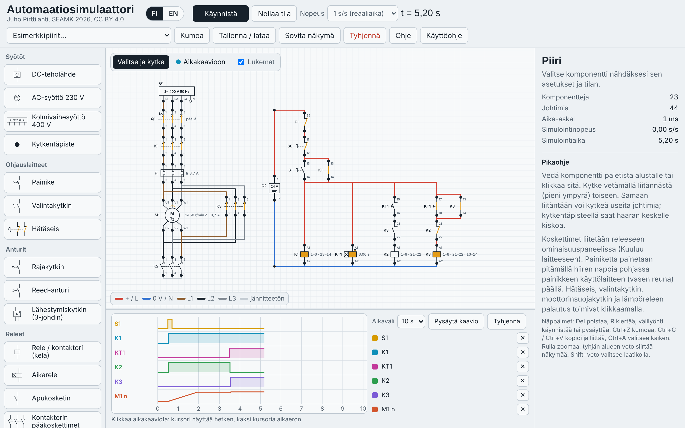
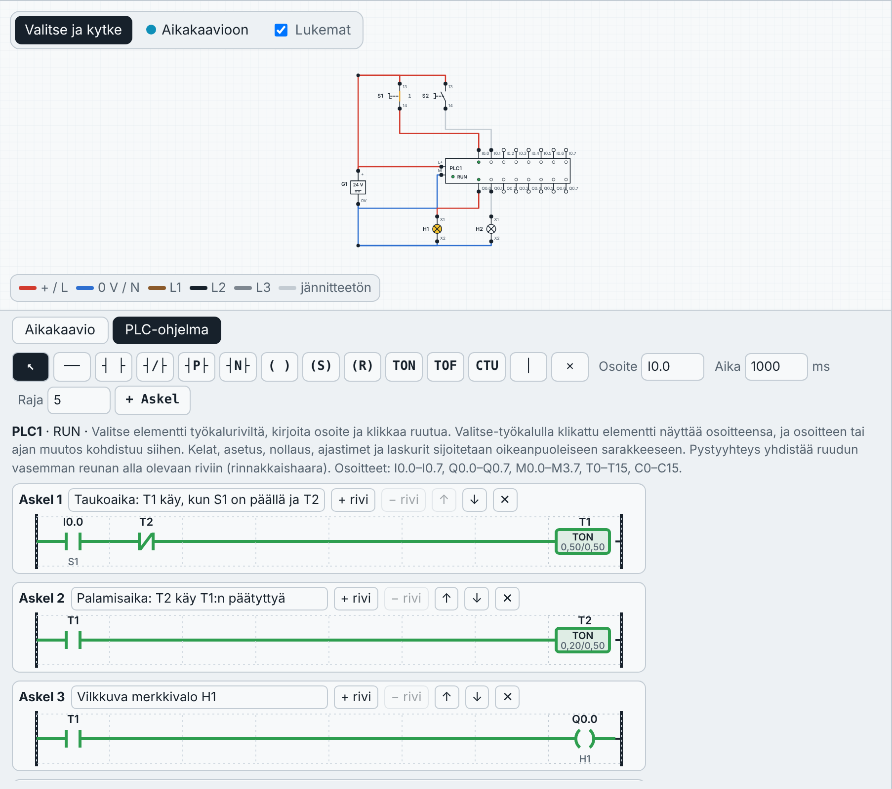
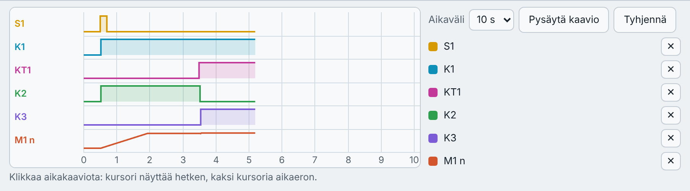

# Automaatiosimulaattori – käyttöohje

> Tämä tiedosto on käyttöohjeen versioitu kopio. Verkkosivuna: <https://jipirtti.github.io/Automaatiosimulaattori/docs/kayttoohje.html>

Juho Pirttilahti, Seinäjoen ammattikorkeakoulu (SEAMK), 2026. Suunnittelu, sisältö ja validointi: Juho Pirttilahti. Ohjelmakoodi toteutettu tekoälyavusteisesti (Claude, Anthropic). Lisenssi CC BY 4.0.

## Mikä simulaattori on

Automaatiosimulaattori on selaimessa toimiva opetusväline relelogiikalle, ohjauspiireille ja PLC-ohjelmoinnille. Piiri piirretään kuten sähköpiirikaavio, ja se toimii heti piirtämisen jälkeen:

- painikkeet painetaan hiirellä
- releet vetävät viiveellä
- sylinterit liikkuvat ja ohjaavat antureita
- moottorit käynnistyvät
- suojalaitteet laukeavat

Aikakaavio näyttää tilojen muutokset ajan funktiona, ja sen kursoreilla mitataan aikoja. PLC:tä ohjelmoidaan tikapuukaaviolla (LD), ja ohjelman tila näkyy ajon aikana.

Avaa simulaattori osoitteessa <https://jipirtti.github.io/Automaatiosimulaattori/>. Asennusta ei tarvita. Simulaattori toimii myös avaamalla tiedoston `index.html` suoraan selaimessa ilman verkkoyhteyttä.

Simulaattori on tarkoitettu ohjauspiirien toiminnan ymmärtämiseen. Sillä ei voi suunnitella todellisia turvatoimintoja eikä osoittaa niiden suorituskykytasoa (PL) (ks. Mallin rajoitukset).

## Näkymän osat

| Alue | Sisältö |
| --- | --- |
| Yläpalkki | Kieli (FI, EN), Käynnistä/Pysäytä, Nollaa tila, simulointinopeus, aika, esimerkkipiirit, Kumoa, Tallenna / lataa, Sovita näkymä, Tyhjennä, Ohje, Käyttöohje, Palaute |
| Paletti (vasen) | Komponentit ryhmittäin: syötöt, ohjauslaitteet, anturit, releet ja logiikka, suojalaitteet, toimilaitteet |
| Piirtoalusta (keskellä) | Piiri, työkalurivi (Valitse ja kytke, Aikakaavioon, Lukemat), johtimien värien selite ja varoitukset |
| Ominaisuuspaneeli (oikea) | Valitun komponentin tunnus, ohjaus, asetukset ja tila |
| Alapaneeli | Välilehdet *Aikakaavio* (enintään kahdeksan signaalia, aikaväli, kursorit) ja *PLC-ohjelma* (tikapuukaavioeditori) |

Johtimen väri kertoo sen jännitteen:

| Väri | Merkitys |
| --- | --- |
| Punainen | Ohjausjännitteen + tai L. Turvareleen kanavat S11–S12, S21–S22 ja kuittauspiiri S33–S34 näkyvät punaisina, kun rele on jännitteinen. |
| Sininen | 0 V tai N |
| Ruskea, musta, harmaa | L1, L2, L3 (IEC 60445) |
| Vaalea ja ohut | Jännitteetön tai yhteydetön johdin |

Johtimen tilan näet myös viemällä hiiren sen päälle.

## Piirin rakentaminen

### Komponentit, johtimet ja kiskot

- Vedä komponentti paletista piirtoalustalle tai klikkaa sitä. Siirrä vetämällä, kierrä R-näppäimellä ja poista Delete-näppäimellä.
- Kytke johdin vetämällä liitännästä (pieni ympyrä) toiseen. Samaan liitäntään voi kytkeä useita johtimia.
- Ohjauspiiri piirretään pystyhaaroina +24 V:n ja 0 V:n kiskon väliin. Kisko syntyy, kun kytket teholähteen napaan **kytkentäpisteen** ja vedät siitä johtimet haarojen ylä- tai alapäihin. Esimerkkipiirit on piirretty näin.
- Johtimen reittiä muutetaan vetämällä johtimen osaa. Kaksoisklikkaus palauttaa automaattisen reitin.
- Useita komponentteja valitaan Shift+vedolla tai Shift+klikkauksella. Ctrl+C ja Ctrl+V kopioivat ja liittävät.

### Kela ja koskettimet

Kuten piirikaaviossa, releen kela ja sen koskettimet ovat erillisiä komponentteja:

1. Lisää **rele / kontaktori (kela)**. Sen tunnus (esimerkiksi K1) näkyy kelan vieressä. Tunnuksen voi muuttaa ominaisuuspaneelissa.
2. Lisää **apukosketin** ja valitse ominaisuuspaneelissa *Kuuluu laitteeseen*: K1. Uusi kosketin liitetään valmiiksi viimeksi lisättyyn releeseen.
3. Valitse *Kosketin*: sulkeutuva (NO) tai avautuva (NC), ja kosketinnumero (1. numero).
4. Kontaktorin kolmivaiheiset **pääkoskettimet** (1–2, 3–4, 5–6) lisätään omana komponenttinaan ja liitetään kontaktoriin samalla tavalla.

Kelan vieressä näkyy luettelo sen koskettimista (ristiviittaus), esimerkiksi *1–6 · 13–14 · 21–22*. Kun releen tunnusta muutetaan, sen koskettimet seuraavat mukana.

| Laite | Sulkeutuva (NO) | Avautuva (NC) |
| --- | --- | --- |
| Rele, kontaktori, moottorinsuojakytkin | n3–n4 (13–14, 23–24 …) | n1–n2 (11–12, 21–22 …) |
| Aikarele | n7–n8 (17–18 …) | n5–n6 (15–16 …) |
| Lämpörele | 97–98 | 95–96 |
| Painike, raja- ja reed-kytkin | 13–14 | 11–12 |

## Komponentit

| Komponentti | Liitännät | Asetukset ja toiminta |
| --- | --- | --- |
| DC-teholähde | +, 0V | Jännite (24 V). Oikosulku laukaisee suojauksen; kuittaa klikkaamalla lähdettä. |
| AC-syöttö 230 V | L, N | Jännite. Toimii ohjausjännitteenä kuten DC-teholähde. |
| Kolmivaihesyöttö 400 V | L1, L2, L3, N | Pääjännite. Pääpiirin oikosulku laukaisee moottorinsuojakytkimen tai, jos sellaista ei ole, syötön sulakkeet. |
| Kytkentäpiste | 1 | Johtimien yhtymäkohta (kisko, haara). |
| Painike | 13–14 tai 11–12 | Kosketin NO/NC, toiminta palautuva tai lukittuva. Palautuvaa painetaan pitämällä hiiren nappia pohjassa painikkeen käyttölaitteen (vasen reuna) päällä. |
| Valintakytkin | 13–14 tai 11–12 | Asento 0/1, vaihtuu klikkaamalla. |
| Hätäseis | 11–12, 21–22 | Kaksi avautuvaa kosketinta (kaksi kanavaa). Painetaan ja vapautetaan klikkaamalla. |
| Rajakytkin, reed-anturi | 13–14 tai 11–12 | Toimilaite (sylinteri) ja asento (etu/taka). Ilman toimilaitetta anturia ohjataan klikkaamalla. |
| Lähestymiskytkin (3-johdin) | BN, BK, BU | Tyyppi (induktiivinen, kapasitiivinen, optinen), lähtö PNP (kytkee BN:n BK:hon) tai NPN (kytkee BK:n BU:hun), NO/NC. Toimii vain, kun BN–BU-syöttö on kytketty. |
| Rele / kontaktori (kela) | A1, A2 | Laji: apurele (veto- ja päästöaika 10 ms) tai kontaktori (25 ms). Nimellisjännite 24 V DC, 230 V AC tai 400 V AC. |
| Aikarele | A1, A2 | Toiminto: vetoviive (kosketin vaihtaa ajan T kuluttua ohjauksesta) tai päästöviive (kosketin vaihtaa heti ja palaa ajan T kuluttua ohjauksen poistosta). Asetusaika T. |
| Apukosketin | n3–n4 / n1–n2 | Kuuluu laitteeseen (rele, aikarele, lämpörele, moottorinsuojakytkin), NO/NC, numero. |
| Kontaktorin pääkoskettimet | 1–2, 3–4, 5–6 | Kuuluu kontaktoriin. |
| Turvarele | A1, A2, S11–S12, S21–S22, S33–S34, 13–14, 23–24 | Käynnistys valvottu tai automaattinen (ks. Turvarele). |
| PLC | L+, M, I0.0–I0.7, Q0.0–Q0.7 | Kierrosaika (10 ms). RUN/STOP vaihtuu klikkaamalla PLC:n vasenta alakulmaa tai ominaisuuspaneelista (ks. PLC ja tikapuukaavio). |
| Moottorinsuojakytkin | 1–6 | Asetusvirta Ir. Kytketään päälle ja pois klikkaamalla. Laukeaa ylikuormasta (lämpömalli) ja oikosulusta (magneettinen laukaisu). |
| Lämpörele | 1–6 (+ 95–96, 97–98 apukoskettimina) | Asetusvirta Ir, palautus käsin tai automaattisesti. Laukeaminen avaa 95–96 ja sulkee 97–98. Pääkoskettimet pysyvät kiinni. |
| Merkkilamppu | X1, X2 | Väri, nimellisjännite. |
| Magneettiventtiilin kela | A1, A2 | Sylinteri ja suunta (ulos +, sisään −). |
| Pneumatiikkasylinteri ja 5/2-venttiili | – | Venttiili monostabiili (jousipalautus) tai bistabiili (kaksi kelaa), liikeaika ulos ja sisään. Sylinteri ohjataan magneettiventtiilin keloilla. |
| Oikosulkumoottori 3~ | U1, V1, W1 | Nimellisvirta In, kiihdytysaika, kuormitus (nimellinen, ylikuorma 200 %, akseli jumissa). |
| Oikosulkumoottori 3~ (6 napaa) | U1, V1, W1, U2, V2, W2 | Kuten edellä. Tähti: U2, V2, W2 yhteen. Kolmio: U1–W2, V1–U2, W1–V2. |

### Kuorman toiminta

Kela, merkkilamppu ja anturin syöttö toimivat, kun niiden navat ovat yhteydessä saman lähteen eri napoihin ja jännite on vähintään 70 % nimellisjännitteestä. Jos jännite on yli 130 % nimellisjännitteestä, tulee varoitus.

Tästä seuraa kaksi asiaa:

- Kaksi 24 V:n kelaa sarjassa 24 V:n syötössä ei vedä, koska kummallekin jää 12 V.
- 230 V:n kela ei vedä 24 V:n syötöstä.

### Moottori

- **Pyörimissuunta** määräytyy vaihejärjestyksestä: L1–L2–L3 liitäntöihin U–V–W pyörittää myötäpäivään. Kahden vaiheen vaihtaminen kääntää suunnan.
- **Tähti–kolmio:** moottori tunnistaa kytkennän (Y tai Δ) liitäntöjen vaiheista. Tähdessä käynnistysvirta on 2·In ja kiihdytys kolme kertaa hitaampi kuin kolmiossa, jossa käynnistysvirta on 6·In.
- **Virta** laskee käynnistysvirrasta nimellisvirtaan nopeuden kasvaessa. Kuormitus vaikuttaa virtaan:
  - ylikuorma: 2·In
  - jumittunut akseli: käynnistysvirta jatkuvasti
  - puuttuva vaihe: pysähdyksissä 5·In; jo pyörivä moottori jatkaa noin 1,7-kertaisella virralla

### Lämpörele ja moottorinsuojakytkin

Laukeaminen lasketaan lämpömallista, jossa lämpenemä h seuraa virran neliötä aikavakiolla τ = 100 s:

dh/dt = ((I/Ir)² − h)/τ, laukeaa kun h ≥ 1,44 (pysyvä virta 1,2·Ir)

Laukeamisaika virtasuhteella r = I/Ir ja alkulämpenemällä h0:

t = −τ · ln((r² − 1,44) / (r² − h0))

Esimerkiksi kylmänä (h0 = 0) virralla 2·Ir t = 44,6 s ja virralla 6·Ir t = 4,1 s.

Lämpörele voidaan palauttaa vasta, kun lämpenemä on laskenut alle arvon 1,2. Moottorinsuojakytkimen ominaisuuspaneeli näyttää moottorivirran, lämpenemän ja arvioidun laukeamisajan.

### Turvarele

Turvarele valvoo kaksikanavaista hätäseispiiriä:

- Kanava 1 on S11–S12, kanava 2 on S21–S22. Hätäseisin koskettimet 11–12 ja 21–22 kytketään kanaviin.
- Kuittauspiiri on S33–S34. Siihen kytketään kuittauspainike sarjassa kontaktoreiden avautuvien koskettimien kanssa (takaisinkytkentä).
- Lähdöt 13–14 ja 23–24 ohjaavat kontaktoreita.

| Tilanne | Toiminta |
| --- | --- |
| Molemmat kanavat kiinni, kuittaus | Valvottu käynnistys: lähdöt sulkeutuvat, kun kuittauspiiri aukeaa (painikkeen vapautus, laskeva reuna). Automaattinen: lähdöt sulkeutuvat, kun kuittauspiiri on kiinni. |
| Hätäseis painetaan | Lähdöt aukeavat heti. |
| Vain toinen kanava aukeaa (esimerkiksi hitsautunut kosketin) | Lähdöt aukeavat ja rele lukittuu (kanavat eriävät), kunnes molemmat kanavat on avattu. |
| Kanavien välinen oikosulku | Lähdöt eivät kytkeydy, lukitus. |
| Kontaktorin kosketin hitsautunut | Kontaktorin peilikosketin (avautuva apukosketin) jää auki, joten kuittauspiiri ei sulkeudu eikä uudelleenkäynnistys onnistu. |

Etupaneelin merkkivalot ovat vasemmalta oikealle syöttö, kanava 1, kanava 2, lähdöt ja vika (punainen).

## PLC ja tikapuukaavio

### Kytkentä

- **Syöttö:** PLC:n L+ ja M kytketään 24 V:n teholähteeseen.
- **Tulot:** tulot I0.0–I0.7 ovat 1, kun niiden jännite M:ää vasten on vähintään 15 V. Painikkeet ja anturit kytketään siis +24 V:sta tuloon. 3-johdinanturit kytketään PNP-lähdöllä.
- **Lähdöt:** lähdöt Q0.0–Q0.7 ovat PNP-tyyppisiä. Lähdön ollessa 1 PLC kytkee L+:n lähtöliitäntään, joten kuorma (kela, lamppu, magneettiventtiili) kytketään lähdön ja 0 V:n väliin.
- **Merkkivalot:** PLC:n merkkivalot näyttävät tulojen ja lähtöjen tilat sekä RUN/STOP-tilan.

### Ohjelmakierto

PLC suorittaa ohjelmaa kierroksittain (oletus 10 ms):

1. Kierroksen alussa tulot luetaan prosessikuvaan.
2. Askeleet suoritetaan järjestyksessä ylhäältä alas.
3. Kierroksen lopussa lähdöt kirjoitetaan.

Siksi tulon muutos näkyy ohjelmassa enintään yhden kierron viiveellä. STOP-tilassa lähdöt ovat pois ja ohjelma ei suoriudu.

### Editori

Avaa editori alapaneelin välilehdeltä **PLC-ohjelma** tai PLC:n ominaisuuspaneelin painikkeella *Avaa PLC-ohjelma*.

Askeleen rakenne:

- Jokaisessa askeleessa on seitsemän sarakkeen kosketinalue ja oikeanpuoleinen lähtösarake.
- Rivejä voi olla enintään neljä.
- Vasen kisko syöttää jokaisen rivin alkua.

| Elementti | Merkintä | Toiminta |
| --- | --- | --- |
| Johdin | ── | Johtaa aina |
| Sulkeutuva kosketin | ┤ ├ | Johtaa, kun operandi on 1 |
| Avautuva kosketin | ┤/├ | Johtaa, kun operandi on 0 |
| Nouseva reuna | ┤P├ | Johtaa yhden kierroksen, kun operandi muuttuu 0 → 1 |
| Laskeva reuna | ┤N├ | Johtaa yhden kierroksen, kun operandi muuttuu 1 → 0 |
| Kela | ( ) | Operandi = askeleen tila |
| Asetus | (S) | Asettaa operandin 1:ksi, kun askel johtaa (pysyy) |
| Nollaus | (R) | Nollaa operandin; ajastimelle ja laskurille nollaa ajan tai laskennan |
| Vetoviive | TON | Lähtö T = 1, kun tulo on ollut 1 asetusajan |
| Päästöviive | TOF | Lähtö T = 1 heti; palaa 0:ksi asetusajan kuluttua tulon 0:ksi menosta |
| Ylöslaskuri | CTU | Laskee tulon nousevat reunat; lähtö C = 1, kun laskenta ≥ raja |
| Pystyyhteys | │ | Yhdistää ruudun vasemman reunan alla olevaan riviin (rinnakkaishaara = TAI, tai yksi ehto usealle lähdölle) |

Operandit:

| Operandi | Osoitteet |
| --- | --- |
| Tulot | I0.0–I0.7 |
| Lähdöt | Q0.0–Q0.7 |
| Merkkerit (muistibitit) | M0.0–M3.7 |
| Ajastimet | T0–T15 |
| Laskurit | C0–C15 |

Koskettimen operandina ajastin tai laskuri tarkoittaa sen lähtöbittiä.

Editorin käyttö:

1. Valitse elementti työkaluriviltä.
2. Kirjoita osoite (ja ajastimelle aika, laskurille raja).
3. Klikkaa ruutua.

Valitse-työkalulla klikattu elementti näyttää osoitteensa. Osoitteen, ajan tai rajan muutos kohdistuu silloin siihen. Askelia lisätään painikkeella *+ Askel*. Askeleen otsikkorivillä lisätään ja poistetaan rivejä, siirretään askelta ja kirjoitetaan kommentti. Kumoa (Ctrl+Z) toimii myös ohjelmaan.

Ajon aikana jännitteiset polut ja ohjatut lähdöt näkyvät vihreinä. Ajastimissa näkyy kulunut aika ja laskureissa laskenta. Osoitteen alla on laite, joka on kytketty kyseiseen tuloon tai lähtöön (esimerkiksi S1 tai H1).

PLC-ohjelma tallentuu piirin mukana (selain, Tallenna / lataa).

## Viat

Vika asetetaan ominaisuuspaneelin kohdassa *Vika*:

| Komponentti | Viat |
| --- | --- |
| Koskettimet, painikkeet, anturit | Hitsautunut (jää kiinni), ei johda (kulunut) |
| Kontaktorin pääkoskettimet | Napa 1–2 hitsautunut, kaikki navat hitsautuneet |
| Kelat | Kela katkennut |
| Hätäseis | Kanava 1 tai kanava 2 hitsautunut |
| Lähestymiskytkin | Lähtö jää päälle, lähtö ei kytke |
| Johdin | Valitse johdin ja paina *Katkaise* |

Releiden koskettimet ovat **pakko-ohjattuja**: jos releen sulkeutuva kosketin tai kontaktorin pääkosketin hitsautuu, saman releen avautuvat koskettimet eivät sulkeudu. Tähän perustuu kontaktoreiden valvonta turvareleen kuittauspiirissä (takaisinkytkentä).

## Simuloinnin ajaminen

- **Käynnistä / Pysäytä** (välilyönti) ajaa tai pysäyttää simuloinnin.
- **Nollaa tila** palauttaa releet, ajastimet, sylinterit, suojalaitteet ja ajan alkutilaan.
- **Nopeus** on simuloitu aika reaaliaikaista sekuntia kohti: 0,1–10 s/s. Hidastus auttaa näkemään releiden vetojärjestyksen. Nopeutus lyhentää lämpöreleen laukeamisen odotusta.
- Aika-askel on 1 ms. Koskettimen tilan muutos näkyy piirissä seuraavalla askeleella, ja releet vetävät ja päästävät viiveellä (10 tai 25 ms).

## Aikakaavio

- Valitse työkaluriviltä **Aikakaavioon** ja klikkaa komponenttia, tai paina ominaisuuspaneelin *Lisää signaali* -painiketta. Signaaleja voi olla kahdeksan.
- Kaavioon voi lisätä seuraavat tilat:

  | Komponentti | Näkyvä tila |
  | --- | --- |
  | Rele, kontaktori | Koskettimien tila (vetänyt / lepoasennossa) |
  | Aikarele | Lähdön tila |
  | Kosketin | Kiinni / auki |
  | Painike, valintakytkin, hätäseis | Painettu / käännetty |
  | Anturi | Tunnistaa / ei tunnista |
  | Merkkilamppu | Palaa / ei pala |
  | Magneettiventtiilin kela | Ohjattu / ei ohjattu |
  | Turvarele | Lähtöjen tila |
  | Lämpörele | Lauennut |
  | Sylinteri | Asento 0–100 % |
  | Moottori | Pyörimisnopeus |

- **Aikaväli** on 2–60 s. **Pysäytä kaavio** jäädyttää näytön, mutta simulointi jatkuu. **Tyhjennä** poistaa historian.
- Klikkaa kaaviota: ensimmäinen klikkaus asettaa kursorin t₁, toinen kursorin t₂. Kaavion alla näkyy aikaero Δt.

## Esimerkkipiirit

Esimerkit ladataan yläpalkin valikosta. Lataus korvaa nykyisen piirin, mutta Kumoa palauttaa sen. Esimerkeissä on valmiina aikakaavion signaalit.

| Esimerkki | Mitä nähdään | Kokeile |
| --- | --- | --- |
| 1. Itsepitopiiri | S2 käynnistää K1:n, joka pitää itsensä koskettimella 13–14; S1 (NC) pysäyttää. H1 palaa koskettimen 23–24 kautta. | Paina S2 ja vapauta. Paina S1. |
| 2. Moottorin suora käynnistys ja lämpörele | Pääpiiri Q1–K1–F1–M1. Ohjauspiirissä F1 95–96, S0, S1 ∥ K1 13–14. H1 käy, H2 vika (F1 97–98). | Käynnistä S1:llä. Aseta M1:n kuormitukseksi ylikuorma ja nopeudeksi 10 s/s: F1 laukeaa noin 43 s kuluttua. |
| 3. Suunnanvaihto ja ristiinlukitus | K1 eteen, K2 taakse (L1 ja L3 vaihdettu). K1 21–22 ja K2 21–22 lukitsevat toisensa. | Käynnistä S1:llä, paina S2: K2 ei vedä. Pysäytä S0:lla ja paina S2. |
| 4. Tähti–kolmiokäynnistys | K1 verkko, K2 tähti, K3 kolmio, KT1 vetoviive 3 s. K2 ja K3 lukitsevat toisensa. | Paina S1 ja seuraa aikakaaviota: K2 päästää 3,025 s kohdalla ja K3 vetää 25 ms myöhemmin. |
| 5. Vetoviive- ja päästöviiverele | KT1 vetoviive (H1), KT2 päästöviive (H2), T = 3 s. | Käännä S1 ja S2 asentoon 1 ja takaisin. Mittaa viiveet kursoreilla. |
| 6. Sähköpneumatiikka: automaattinen paluu | S1 käynnistää, kun sylinteri on takana (B1). K1 pitää ja ohjaa Y1:n. PNP-anturi B2 (etuasento) vetää K2:n, jonka 21–22 katkaisee pidon. | Paina S1. Sylinteri menee ulos 1,5 s ja palaa 1,0 s. |
| 7. Sekvenssi A+ B+ A− B− | Bistabiilit venttiilit ja reed-anturit: A+ = S1·B3, B+ = B2, A− = B4, B− = B1. | Paina S1 lyhyesti: yksi jakso, 4 s. Pidä S1 pohjassa: jakso toistuu. |
| 8. Hätäseis ja turvarele | S0 kaksikanavaisena turvareleelle K0. Kuittaus S1 sarjassa K1 21–22 ja K2 21–22 kanssa. K1 ja K2 sarjassa pääpiirissä. | Kuittaa S1:llä. Paina S0, vapauta ja kuittaa. Aseta S0:n viaksi kanava 2 hitsautunut tai K1:n pääkoskettimien viaksi napa 1–2 hitsautunut. |
| 9. PLC: käynnistys ja pysäytys | Itsepito ohjelmassa. S0 (NC) tuloon I0.0, S1 (NO) tuloon I0.1, H1 lähtöön Q0.0, H2 lähtöön Q0.1. | Käynnistä ja pysäytä. Katkaise S0:n johdin: miksi PLC pysähtyy? |
| 10. PLC: vilkkuvalo ja laskuri | TON T1 (tauko) ja T2 (palaa) vuorottelevat, CTU C1 laskee vilkahdukset, H2 syttyy viidennestä, S2 nollaa laskurin. | Käännä S1 asentoon 1 ja seuraa PLC-ohjelmaa. Jakso on 1,02 s (2 × 0,5 s + kaksi 10 ms kiertoa). |
| 11. PLC: askelketju A+ B+ A− B− | Sama laitteisto kuin esimerkissä 7, mutta ohjaus askelmerkkereillä M0.1–M0.4 (asetus ja nollaus) ja 0,5 s odotus TON T1:llä. | Paina S1. Pidä S1 pohjassa: jakso ei toistu, koska käynnistys on nousevan reunan (P) varassa. |

### Harjoitustehtäviä

1. Esimerkki 1: vaihda S1 sulkeutuvaksi (NO). Mitä tapahtuu, ja miksi pysäytyspainike on aina avautuva?
2. Esimerkki 1: lisää toinen käynnistyspainike ja toinen pysäytyspainike (kaksi ohjauspaikkaa). Miten ne kytketään?
3. Esimerkki 2: laske lämpöreleen laukeamisaika ylikuormalla kaavalla ja vertaa simulaattoriin. Vaihda lämpöreleen palautus automaattiseksi. Käynnistyykö moottori itsestään? Miksi itsepitopiiri on tässä turvallisuuden kannalta tärkeä?
4. Esimerkki 3: poista ristiinlukitus (korvaa K2 21–22 johtimella). Mitä tapahtuu, jos painat S1 ja sitten S2 pysäyttämättä välillä? Miksi pääpiirissä syntyy oikosulku, ja mikä laite sen katkaisee?
5. Esimerkki 4: muuta tähtiaikaa. Mitä tapahtuu, jos K3:n piiristä puuttuu K2 21–22 ja K3 vetää ennen kuin K2 on päästänyt?
6. Esimerkki 5: tee merkkivalo, joka vilkkuu 1 s päällä ja 1 s pois kahdella vetoviiverele.
7. Esimerkki 6: korvaa B2 rajakytkimellä (NC) ilman K2:ta. Toimiiko piiri samoin?
8. Esimerkki 7: suunnittele sekvenssi A+ A− B+ B−. Miksi suora kytkentä antureista keloihin ei toimi, ja miten ongelma ratkaistaan releillä (kaskadi)?
9. Esimerkki 8: aseta hätäseisille vika *Kanava 2 hitsautunut*. Mitä turvarele tekee, ja miten vika havaitaan? Toista kontaktorin K1 pääkoskettimen hitsautumisella. Miksi pääpiirissä on kaksi kontaktoria sarjassa?
10. Esimerkki 8: vaihda turvareleen käynnistys automaattiseksi ja kytke S33–S34 suoraan yhteen. Miksi tämä ei ole sallittua hätäseisin yhteydessä?
11. Esimerkki 9: muuta pysäytyspainike S0 sulkeutuvaksi ja ohjelma vastaavasti (I0.0 avautuvaksi koskettimeksi). Toimiiko ohjaus? Mitä tapahtuu, kun S0:n johdin katkeaa?
12. Esimerkki 10: tee vilkkuvalo yhdellä ajastimella ja M-bitillä. Muuta laskuri laskemaan 10 vilkahdusta ja pysäyttämään vilkkuvalo.
13. Esimerkki 11: lisää jaksojen laskuri ja jatkuva käyntitila valintakytkimellä (tulo I0.5). Toteuta esimerkin 2 suora käynnistys PLC:llä niin, että lämpöreleen 95–96 on PLC:n tulona.

## Varoitukset

| Varoitus | Syy ja korjaus |
| --- | --- |
| Oikosulku, teholähteen suojaus laukesi | Ohjauspiirin + ja 0 V ovat yhteydessä ilman kuormaa. Korjaa kytkentä ja kuittaa klikkaamalla lähdettä. |
| Oikosulku pääpiirissä | Kaksi vaihetta tai vaihe ja N ovat yhteydessä. Moottorinsuojakytkin tai syöttö laukeaa. |
| Moottorinsuojakytkin laukesi | Oikosulku (magneettinen laukaisu) tai ylikuorma. |
| Lämpörele laukesi | Ylikuorma, jumittunut akseli tai puuttuva vaihe. |
| Jännite ylittää nimellisjännitteen | Kelan tai lampun nimellisjännite ei vastaa syöttöä. |
| Vain kaksi vaihetta | Vaihe puuttuu (katkennut johdin, kosketin auki). |
| Käämien toiset päät kytkemättä | 6-napaisen moottorin tähtipiste tai kolmiokytkentä puuttuu. |
| Virheellinen käämikytkentä | Käämien päät on kytketty väärin. |
| Turvareleen kanavat eriävät / kanavien välinen oikosulku | Hätäseispiirin vika. Lähdöt pysyvät auki, kunnes vika on korjattu ja molemmat kanavat avattu. |
| Venttiilin molemmat kelat ohjattuina | Bistabiilin venttiilin signaaliristiriita. |
| Rele värähtelee | Rele katkaisee oman ohjauksensa, esimerkiksi oman avautuvan koskettimensa kautta. |
| Kelaa tai laitetta ei ole valittu | Kosketinta tai magneettiventtiilin kelaa ei ole liitetty laitteeseen. |
| PLC:llä ei ole syöttöä | L+ ja M eivät ole kytkettyinä 24 V:iin. Lähdöt ovat pois. |

## Tallennus ja jakaminen

Piiri tallentuu automaattisesti selaimeen, ja se on tallessa, kun avaat sivun uudelleen. **Tallenna / lataa** näyttää piirin tekstinä (JSON), jonka voi kopioida talteen, lähettää toiselle tai liittää palauteissueen. Teksti sisältää komponentit, asetukset, viat, johtimet ja aikakaavion signaalit. Liittämällä tekstin kenttään ja valitsemalla *Lataa* piiri palautuu.

## Palaute

Yläpalkin **Palaute**-painike avaa lomakkeen. Siinä valitaan tyyppi:

- toiminta ei vastaa odotusta
- virhe käyttöliittymässä tai toiminnossa
- kehitysehdotus

Lomake avaa simulaattorin GitHub-repoon valmiiksi täytetyn issuen. Mukaan liitetään automaattisesti simulaattorin versio, kieli, selain, varoitukset ja (valittaessa) nykyinen piiri PLC-ohjelmineen, joten tilanne voidaan toistaa täsmälleen. Issuet ovat julkisia, eikä niihin kirjoiteta henkilötietoja. Ilman GitHub-tiliä raportin voi kopioida tai lähettää sähköpostilla.

## Mallin rajoitukset

Piiri ratkaistaan johtavuustarkasteluna 1 ms:n aika-askeleella. Johtimet ja suljetut koskettimet yhdistävät liitännät ryhmiksi, ja kuorman jännite määräytyy ryhmissä olevista lähteen navoista. Releiden veto- ja päästöajat ovat kiinteät (10 ja 25 ms). Moottorin virta ja nopeus ovat yksinkertaistettuja malleja. Lämpöreleen ja moottorinsuojakytkimen laukeaminen perustuu yhden aikavakion lämpömalliin, joka kuvaa laukaisuluokan 10 käyttäytymistä vain suuntaa-antavasti.

Mallissa ei ole:

- kosketinpomppua eikä valokaarta
- kelojen induktiivisia ilmiöitä
- jännitteenalenemaa johtimissa
- releiden kestoikää
- turvareleen testipulsseja eikä diagnostiikan kattavuutta
- paineilman virtausta eikä painetta
- PLC:n analogisia tuloja ja lähtöjä, muita ohjelmointikieliä (FBD, ST, SFC) eikä aliohjelmia; PLC:ssä on 8 digitaalituloa ja 8 lähtöä

**Simulaattorilla ei voi osoittaa turvatoiminnon suorituskykytasoa (PL, EN ISO 13849-1) eikä suunnitella todellisia turvatoimintoja.** Todellisen järjestelmän suunnittelussa noudatetaan standardeja ja komponenttivalmistajien ohjeita.

## Pikanäppäimet

| Näppäin | Toiminto |
| --- | --- |
| Välilyönti | Käynnistä tai pysäytä |
| Delete / Backspace | Poista valitut |
| R | Kierrä valittua 90° |
| Ctrl+Z | Kumoa |
| Ctrl+C / Ctrl+V | Kopioi ja liitä |
| Ctrl+A | Valitse kaikki |
| Shift+veto tyhjästä | Laatikkovalinta |
| V tai Esc | Valitse ja kytke -työkalu (Esc poistaa myös valinnan) |
| Hiiren rulla | Zoomaus |

## Tekijä ja lisenssi

Automaatiosimulaattori ja käyttöohje: Juho Pirttilahti, Seinäjoen ammattikorkeakoulu (SEAMK), 2026. Suunnittelu, sisältö ja validointi: Juho Pirttilahti. Ohjelmakoodi toteutettu tekoälyavusteisesti (Claude, Anthropic).

Aineisto on lisensoitu [Creative Commons Nimeä 4.0 Kansainvälinen -lisenssillä (CC BY 4.0)](https://creativecommons.org/licenses/by/4.0/deed.fi). Saat kopioida, jakaa ja muokata aineistoa mihin tahansa tarkoitukseen, kunhan mainitset tekijän ja oppilaitoksen, merkitset lisenssin ja kerrot tekemistäsi muutoksista.

Lähdekoodi ja palaute: <https://github.com/Jipirtti/Automaatiosimulaattori>.
