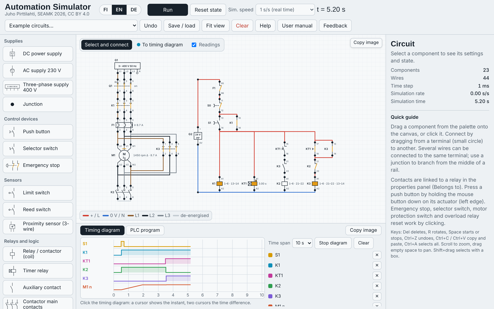
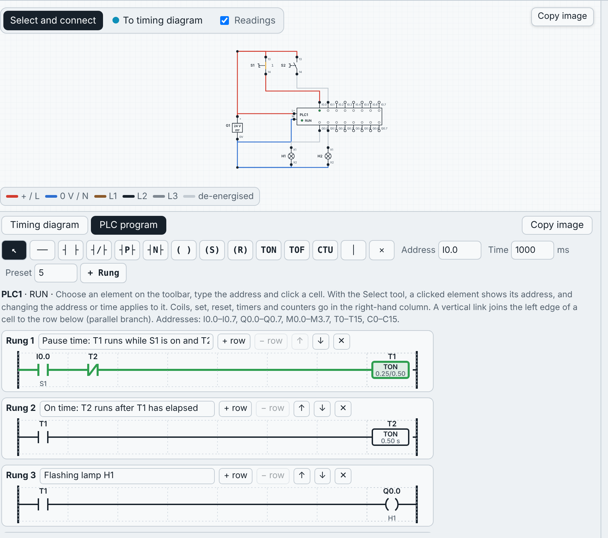
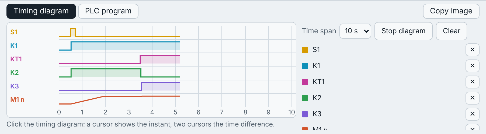

# Automation Simulator – user manual

> This file is the versioned copy of the user manual. As a web page: <https://jipirtti.github.io/Automaatiosimulaattori/docs/user-manual.html>

Juho Pirttilahti, Seinäjoki University of Applied Sciences (SEAMK), 2026. Design, content and validation: Juho Pirttilahti. Code implemented with AI assistance (Claude, Anthropic). Licence CC BY 4.0.

## What the simulator is

The Automation Simulator is a browser-based teaching tool for relay logic, control circuits and PLC programming. A circuit is drawn like an electrical circuit diagram, and it works as soon as it is drawn:

- push buttons are pressed with the mouse
- relays operate with a delay
- cylinders move and operate sensors
- motors start
- protective devices trip

The timing diagram shows the changes of states as a function of time, and its cursors are used to measure times. The PLC is programmed with a ladder diagram (LD), and the state of the program is shown while it runs.

Open the simulator at <https://jipirtti.github.io/Automaatiosimulaattori/?lang=en>. No installation is needed. The simulator also works offline by opening the file `index.html` directly in a browser.

The simulator is intended for understanding how control circuits work. It cannot be used to design real safety functions or to demonstrate their performance level (PL) (see Model limitations).

## Parts of the view

| Area | Content |
| --- | --- |
| Header | Language (FI, EN, DE), Run/Pause, Reset state, simulation speed, time, example circuits, Undo, Save / load, Fit view, Clear, Help, User manual, Feedback |
| Palette (left) | Components by group: supplies, control devices, sensors, relays and logic, protective devices, actuators |
| Canvas (centre) | The circuit, the toolbar (Select and connect, To timing diagram, Readings), the legend of wire colours and warnings |
| Properties panel (right) | Tag, operation, settings and state of the selected component |
| Bottom panel | Tabs *Timing diagram* (up to eight signals, time span, cursors) and *PLC program* (ladder diagram editor) |

The colour of a wire shows its voltage:

| Colour | Meaning |
| --- | --- |
| Red | + or L of the control voltage. The safety relay channels S11–S12, S21–S22 and the reset circuit S33–S34 are shown red when the relay is energised. |
| Blue | 0 V or N |
| Brown, black, grey | L1, L2, L3 (IEC 60445) |
| Light and thin | De-energised or unconnected wire |

You can also see the state of a wire by hovering over it.

## Building a circuit

### Components, wires and rails

- Drag a component from the palette onto the canvas, or click it. Move it by dragging, rotate it with the R key and delete it with the Delete key.
- Connect a wire by dragging from a terminal (small circle) to another. Several wires can be connected to the same terminal.
- A control circuit is drawn as vertical branches between the +24 V and 0 V rails. A rail is created by connecting a **junction** to a terminal of the power supply and drawing wires from it to the top or bottom ends of the branches. The example circuits are drawn this way.
- Reshape the route of a wire by dragging a section of it. A double-click restores the automatic route.
- Several components are selected with Shift+drag or Shift+click. Ctrl+C and Ctrl+V copy and paste.

### Coil and contacts

As in a circuit diagram, the coil of a relay and its contacts are separate components:

1. Add a **relay / contactor (coil)**. Its tag (for example K1) is shown next to the coil. The tag can be changed in the properties panel.
2. Add an **auxiliary contact** and choose *Belongs to*: K1 in the properties panel. A new contact is linked to the most recently added relay by default.
3. Choose *Contact*: normally open (NO) or normally closed (NC), and the contact number (1st digit).
4. The three-phase **main contacts** of a contactor (1–2, 3–4, 5–6) are added as a component of their own and linked to the contactor in the same way.

Next to the coil is a list of its contacts (cross-reference), for example *1–6 · 13–14 · 21–22*. When the tag of a relay is changed, its contacts follow.

| Device | Normally open (NO) | Normally closed (NC) |
| --- | --- | --- |
| Relay, contactor, motor protection switch | n3–n4 (13–14, 23–24 …) | n1–n2 (11–12, 21–22 …) |
| Timer relay | n7–n8 (17–18 …) | n5–n6 (15–16 …) |
| Thermal overload relay | 97–98 | 95–96 |
| Push button, limit and reed switch | 13–14 | 11–12 |

## Components

| Component | Terminals | Settings and operation |
| --- | --- | --- |
| DC power supply | +, 0V | Voltage (24 V). A short circuit trips the protection; reset by clicking the supply. |
| AC supply 230 V | L, N | Voltage. Works as a control voltage like the DC power supply. |
| Three-phase supply 400 V | L1, L2, L3, N | Line voltage. A short circuit in the main circuit trips the motor protection switch or, if there is none, the supply fuses. |
| Junction | 1 | Meeting point of wires (rail, branch). |
| Push button | 13–14 or 11–12 | Contact NO/NC, action momentary or latching. A momentary button is pressed by holding the mouse button down on the button's actuator (left edge). |
| Selector switch | 13–14 or 11–12 | Position 0/1, changes on a click. |
| Emergency stop | 11–12, 21–22 | Two normally closed contacts (two channels). Pressed and released by clicking. |
| Limit switch, reed switch | 13–14 or 11–12 | Actuator (cylinder) and position (front/rear). Without an actuator the sensor is operated by clicking. |
| Proximity sensor (3-wire) | BN, BK, BU | Type (inductive, capacitive, optical), output PNP (switches BN to BK) or NPN (switches BK to BU), NO/NC. Works only when the BN–BU supply is connected. |
| Relay / contactor (coil) | A1, A2 | Kind: control relay (operate and release time 10 ms) or contactor (25 ms). Rated voltage 24 V DC, 230 V AC or 400 V AC. |
| Timer relay | A1, A2 | Function: on-delay (the contact changes over when the time T has elapsed after energising) or off-delay (the contact changes over immediately and returns when the time T has elapsed after de-energising). Set time T. |
| Auxiliary contact | n3–n4 / n1–n2 | Belongs to a device (relay, timer relay, thermal overload relay, motor protection switch), NO/NC, number. |
| Contactor main contacts | 1–2, 3–4, 5–6 | Belong to a contactor. |
| Safety relay | A1, A2, S11–S12, S21–S22, S33–S34, 13–14, 23–24 | Start monitored or automatic (see Safety relay). |
| PLC | L+, M, I0.0–I0.7, Q0.0–Q0.7 | Cycle time (10 ms). RUN/STOP changes by clicking the bottom left corner of the PLC or in the properties panel (see PLC and ladder diagram). |
| Motor protection switch | 1–6 | Current setting Ir. Switched on and off by clicking. Trips on overload (thermal model) and short circuit (magnetic trip). |
| Thermal overload relay | 1–6 (+ 95–96, 97–98 as auxiliary contacts) | Current setting Ir, reset manual or automatic. Tripping opens 95–96 and closes 97–98. The main contacts stay closed. |
| Indicator lamp | X1, X2 | Colour, rated voltage. |
| Solenoid valve coil | A1, A2 | Cylinder and direction (out +, in −). |
| Pneumatic cylinder and 5/2 valve | – | Valve monostable (spring return) or bistable (two solenoids), stroke time out and in. The cylinder is controlled by the solenoid valve coils. |
| Induction motor 3~ | U1, V1, W1 | Rated current In, acceleration time, load (rated, overload 200 %, locked rotor). |
| Induction motor 3~ (6 terminals) | U1, V1, W1, U2, V2, W2 | As above. Star: U2, V2, W2 together. Delta: U1–W2, V1–U2, W1–V2. |

### Operation of loads

A coil, an indicator lamp and the supply of a sensor operate when their terminals are connected to different terminals of the same source and the voltage is at least 70 % of the rated voltage. If the voltage is above 130 % of the rated voltage, a warning is given.

Two things follow from this:

- Two 24 V coils in series on a 24 V supply do not operate, because each gets 12 V.
- A 230 V coil does not operate from a 24 V supply.

### Motor

- The **direction of rotation** is determined by the phase sequence: L1–L2–L3 to terminals U–V–W turns clockwise. Swapping two phases reverses the direction.
- **Star–delta:** the motor recognises the connection (Y or Δ) from the phases at its terminals. In star the starting current is 2·In and the acceleration three times slower than in delta, where the starting current is 6·In.
- The **current** falls from the starting current to the rated current as the speed increases. The load affects the current:
  - overload: 2·In
  - locked rotor: starting current continuously
  - missing phase: 5·In at standstill; a motor already running continues at about 1.7 times the current

### Thermal overload relay and motor protection switch

Tripping is calculated from a thermal model in which the thermal level h follows the square of the current with the time constant τ = 100 s:

dh/dt = ((I/Ir)² − h)/τ, trips when h ≥ 1.44 (steady current 1.2·Ir)

Tripping time with the current ratio r = I/Ir and the initial thermal level h0:

t = −τ · ln((r² − 1.44) / (r² − h0))

For example, from cold (h0 = 0) t = 44.6 s at 2·Ir and t = 4.1 s at 6·Ir.

The thermal overload relay can be reset only when the thermal level has fallen below 1.2. The properties panel of the motor protection switch shows the motor current, the thermal level and the estimated tripping time.

### Safety relay

The safety relay monitors a two-channel emergency stop circuit:

- Channel 1 is S11–S12, channel 2 is S21–S22. The emergency stop contacts 11–12 and 21–22 are connected to the channels.
- The reset circuit is S33–S34. A reset button is connected to it in series with the normally closed contacts of the contactors (feedback loop).
- Outputs 13–14 and 23–24 control the contactors.

| Situation | Operation |
| --- | --- |
| Both channels closed, reset | Monitored start: the outputs close when the reset circuit opens (button released, falling edge). Automatic: the outputs close when the reset circuit is closed. |
| Emergency stop pressed | The outputs open immediately. |
| Only one channel opens (for example a welded contact) | The outputs open and the relay locks out (channels differ) until both channels have been opened. |
| Cross short between the channels | The outputs do not close, lockout. |
| Contactor contact welded | The mirror contact of the contactor (normally closed auxiliary contact) stays open, so the reset circuit does not close and a restart is not possible. |

The indicator lights on the front panel are, from left to right, supply, channel 1, channel 2, outputs and fault (red).

## PLC and ladder diagram

### Wiring

- **Supply:** the PLC's L+ and M are connected to a 24 V power supply.
- **Inputs:** inputs I0.0–I0.7 are 1 when their voltage to M is at least 15 V. Push buttons and sensors are therefore connected from +24 V to the input. 3-wire sensors are connected with a PNP output.
- **Outputs:** outputs Q0.0–Q0.7 are of PNP type. When an output is 1, the PLC switches L+ to the output terminal, so the load (coil, lamp, solenoid valve) is connected between the output and 0 V.
- **Indicator lights:** the PLC's indicator lights show the states of the inputs and outputs and the RUN/STOP state.

### Program cycle

The PLC executes the program cycle by cycle (default 10 ms):

1. At the start of the cycle the inputs are read into the process image.
2. The rungs are executed in order from top to bottom.
3. At the end of the cycle the outputs are written.

A change of an input is therefore seen in the program with a delay of at most one cycle. In the STOP state the outputs are off and the program is not executed.

### Editor

Open the editor from the **PLC program** tab of the bottom panel or with the *Open PLC program* button in the PLC's properties panel.

Structure of a rung:

- Each rung has a contact area of seven columns and an output column on the right.
- There can be up to four rows.
- The left rail feeds the start of each row.

| Element | Symbol | Operation |
| --- | --- | --- |
| Wire | ── | Always conducts |
| Normally open contact | ┤ ├ | Conducts when the operand is 1 |
| Normally closed contact | ┤/├ | Conducts when the operand is 0 |
| Rising edge | ┤P├ | Conducts for one cycle when the operand changes 0 → 1 |
| Falling edge | ┤N├ | Conducts for one cycle when the operand changes 1 → 0 |
| Coil | ( ) | Operand = state of the rung |
| Set | (S) | Sets the operand to 1 when the rung conducts (stays) |
| Reset | (R) | Resets the operand; for a timer or counter resets the time or count |
| On-delay | TON | Output T = 1 when the input has been 1 for the preset time |
| Off-delay | TOF | Output T = 1 immediately; returns to 0 when the preset time has elapsed after the input went to 0 |
| Up counter | CTU | Counts the rising edges of the input; output C = 1 when the count ≥ preset |
| Vertical link | │ | Joins the left edge of a cell to the row below (parallel branch = OR, or one condition for several outputs) |

Operands:

| Operand | Addresses |
| --- | --- |
| Inputs | I0.0–I0.7 |
| Outputs | Q0.0–Q0.7 |
| Markers (memory bits) | M0.0–M3.7 |
| Timers | T0–T15 |
| Counters | C0–C15 |

As the operand of a contact, a timer or counter means its output bit.

Using the editor:

1. Choose an element on the toolbar.
2. Type the address (and the time for a timer, the preset for a counter).
3. Click a cell.

With the Select tool, a clicked element shows its address. A change of the address, time or preset then applies to it. Rungs are added with the *+ Rung* button. On the header row of a rung you add and remove rows, move the rung and write a comment. Undo (Ctrl+Z) also works for the program.

While running, energised paths and controlled outputs are shown in green. Timers show the elapsed time and counters the count. Below the address is the device connected to that input or output (for example S1 or H1).

The PLC program is saved with the circuit (browser, Save / load).

## Faults

A fault is set in the properties panel under *Fault*:

| Component | Faults |
| --- | --- |
| Contacts, push buttons, sensors | Welded (stays closed), does not conduct (worn) |
| Contactor main contacts | Pole 1–2 welded, all poles welded |
| Coils | Coil open circuit |
| Emergency stop | Channel 1 or channel 2 welded |
| Proximity sensor | Output stuck on, output never switches |
| Wire | Select the wire and press *Break* |

The relay contacts are **mechanically linked** (force-guided): if a normally open contact of a relay or a main contact of a contactor welds, the normally closed contacts of the same relay do not close. The monitoring of contactors in the reset circuit of a safety relay (feedback loop) is based on this.

## Running the simulation

- **Run / Pause** (Space) runs or stops the simulation.
- **Reset state** returns relays, timers, cylinders, protective devices and the time to their initial state.
- **Speed** is the simulated time per real-time second: 0.1–10 s/s. Slowing down helps to see the operating order of the relays. Speeding up shortens the wait for the thermal overload relay to trip.
- The time step is 1 ms. A change in the state of a contact is seen in the circuit at the next step, and relays operate and release with a delay (10 or 25 ms).

## Timing diagram

- Choose **To timing diagram** on the toolbar and click a component, or press the *Add signal* button in the properties panel. There can be eight signals.
- The following states can be added to the diagram:

  | Component | State shown |
  | --- | --- |
  | Relay, contactor | State of the contacts (energised / at rest) |
  | Timer relay | State of the output |
  | Contact | Closed / open |
  | Push button, selector switch, emergency stop | Pressed / turned |
  | Sensor | Detecting / not detecting |
  | Indicator lamp | Lit / not lit |
  | Solenoid valve coil | Energised / not energised |
  | Safety relay | State of the outputs |
  | Thermal overload relay | Tripped |
  | Cylinder | Position 0–100 % |
  | Motor | Speed |

- The **time span** is 2–60 s. **Stop diagram** freezes the display, but the simulation continues. **Clear** deletes the history.
- Click the diagram: the first click sets cursor t₁, the second cursor t₂. The time difference Δt is shown below the diagram.

## Example circuits

The examples are loaded from the menu in the header. Loading replaces the current circuit, but Undo restores it. The examples have the timing diagram signals ready.

| Example | What is seen | Try |
| --- | --- | --- |
| 1. Self-holding circuit | S2 starts K1, which holds itself with contact 13–14; S1 (NC) stops. H1 lights via contact 23–24. | Press and release S2. Press S1. |
| 2. Direct-on-line start with thermal overload relay | Main circuit Q1–K1–F1–M1. In the control circuit F1 95–96, S0, S1 ∥ K1 13–14. H1 running, H2 fault (F1 97–98). | Start with S1. Set the load of M1 to overload and the speed to 10 s/s: F1 trips after about 43 s. |
| 3. Reversing with interlocking | K1 forward, K2 reverse (L1 and L3 swapped). K1 21–22 and K2 21–22 interlock each other. | Start with S1, press S2: K2 does not operate. Stop with S0 and press S2. |
| 4. Star–delta start | K1 mains, K2 star, K3 delta, KT1 on-delay 3 s. K2 and K3 interlock each other. | Press S1 and follow the timing diagram: K2 releases at 3.025 s and K3 operates 25 ms later. |
| 5. On-delay and off-delay timers | KT1 on-delay (H1), KT2 off-delay (H2), T = 3 s. | Turn S1 and S2 to position 1 and back. Measure the delays with the cursors. |
| 6. Electro-pneumatics: automatic return | S1 starts when the cylinder is retracted (B1). K1 holds and controls Y1. PNP sensor B2 (front position) operates K2, whose 21–22 breaks the hold. | Press S1. The cylinder extends in 1.5 s and returns in 1.0 s. |
| 7. Sequence A+ B+ A− B− | Bistable valves and reed switches: A+ = S1·B3, B+ = B2, A− = B4, B− = B1. | Press S1 briefly: one cycle, 4 s. Hold S1 down: the cycle repeats. |
| 8. Emergency stop with a safety relay | S0 as two channels to safety relay K0. Reset S1 in series with K1 21–22 and K2 21–22. K1 and K2 in series in the main circuit. | Reset with S1. Press S0, release and reset. Set the fault of S0 to channel 2 welded or the fault of K1's main contacts to pole 1–2 welded. |
| 9. PLC: start and stop | Self-holding in the program. S0 (NC) to input I0.0, S1 (NO) to input I0.1, H1 to output Q0.0, H2 to output Q0.1. | Start and stop. Break the wire of S0: why does the PLC stop? |
| 10. PLC: flasher and counter | TON T1 (pause) and T2 (on) alternate, CTU C1 counts the flashes, H2 lights from the fifth, S2 resets the counter. | Turn S1 to position 1 and follow the PLC program. The period is 1.02 s (2 × 0.5 s + two 10 ms cycles). |
| 11. PLC: step sequence A+ B+ A− B− | The same hardware as in example 7, but controlled with step markers M0.1–M0.4 (set and reset) and a 0.5 s wait with TON T1. | Press S1. Hold S1 down: the cycle does not repeat, because the start depends on the rising edge (P). |

### Exercises

1. Example 1: change S1 to normally open (NO). What happens, and why is a stop button always normally closed?
2. Example 1: add a second start button and a second stop button (two control locations). How are they connected?
3. Example 2: calculate the tripping time of the thermal overload relay at overload with the formula and compare with the simulator. Change the reset of the overload relay to automatic. Does the motor start by itself? Why is the self-holding circuit important for safety here?
4. Example 3: remove the interlocking (replace K2 21–22 with a wire). What happens if you press S1 and then S2 without stopping in between? Why does a short circuit occur in the main circuit, and which device breaks it?
5. Example 4: change the star time. What happens if K2 21–22 is missing from the circuit of K3 and K3 operates before K2 has released?
6. Example 5: make an indicator lamp that flashes 1 s on and 1 s off with two on-delay timers.
7. Example 6: replace B2 with a limit switch (NC) without K2. Does the circuit work the same way?
8. Example 7: design the sequence A+ A− B+ B−. Why does direct wiring from the sensors to the coils not work, and how is the problem solved with relays (cascade)?
9. Example 8: set the fault *Channel 2 welded* on the emergency stop. What does the safety relay do, and how is the fault detected? Repeat with a welded main contact of contactor K1. Why are there two contactors in series in the main circuit?
10. Example 8: change the start of the safety relay to automatic and connect S33–S34 directly together. Why is this not permitted with an emergency stop?
11. Example 9: change the stop button S0 to normally open and the program accordingly (I0.0 as a normally closed contact). Does the control work? What happens when the wire of S0 breaks?
12. Example 10: make the flasher with one timer and an M bit. Change the counter to count 10 flashes and stop the flasher.
13. Example 11: add a cycle counter and a continuous mode with a selector switch (input I0.5). Implement the direct-on-line start of example 2 with the PLC so that the overload relay's 95–96 is a PLC input.

## Warnings

| Warning | Cause and remedy |
| --- | --- |
| Short circuit, the power supply protection tripped | + and 0 V of the control circuit are connected without a load. Correct the wiring and reset by clicking the supply. |
| Short circuit in the main circuit | Two phases or a phase and N are connected. The motor protection switch or the supply trips. |
| The motor protection switch tripped | Short circuit (magnetic trip) or overload. |
| The overload relay tripped | Overload, locked rotor or missing phase. |
| Voltage exceeds the rated voltage | The rated voltage of a coil or lamp does not match the supply. |
| Only two phases | A phase is missing (broken wire, contact open). |
| The other winding ends not connected | The star point or delta connection of a 6-terminal motor is missing. |
| Incorrect winding connection | The winding ends are connected wrongly. |
| Safety relay channels differ / cross short between the channels | Fault in the emergency stop circuit. The outputs stay open until the fault is corrected and both channels have been opened. |
| Both valve solenoids energised | Signal conflict of a bistable valve. |
| A relay oscillates | A relay interrupts its own control, for example through its own normally closed contact. |
| The coil or device is not selected | A contact or solenoid valve coil is not linked to a device. |
| The PLC has no supply | L+ and M are not connected to 24 V. The outputs are off. |

## Saving and sharing

The circuit is saved automatically in the browser and is there when you open the page again. **Save / load** shows the circuit as text (JSON) that can be copied for safekeeping, sent to someone else or attached to a feedback issue. The text contains the components, settings, faults, wires and timing diagram signals. Pasting the text into the field and choosing *Load* restores the circuit.

## Copying a chart as an image

Every chart has a **Copy image** button in its corner. It copies the chart to the clipboard as a PNG image that can be pasted directly into a report, a slide or a message (Ctrl+V).

- The image is always drawn on a light background, even when the simulator is in a dark theme, and at double resolution.
- The image contains the chart title, the chart, the legend and a source note (simulator name, Juho Pirttilahti, SEAMK, CC BY 4.0, web address and date).
- The buttons are in the top right corner of the canvas (circuit diagram and wire colour legend) and on the tab row of the bottom panel. On the Timing diagram tab the timing diagram is copied, on the PLC program tab the whole ladder diagram with its rungs and comments.
- The whole circuit diagram is copied regardless of the zoom and the visible area. Selection frames and the background grid are left out.
- If the browser does not allow copying to the clipboard, the image opens in a window. From there it can be copied with the right mouse button (on a phone with a long press) or saved as a PNG file.

## Feedback

The **Feedback** button in the header opens a form. In it you choose the type:

- behaviour does not match expectation
- bug in the interface or a function
- improvement idea

The form opens a pre-filled issue in the simulator's GitHub repository. The simulator version, language, browser, warnings and (if chosen) the current circuit with its PLC program are attached automatically, so the situation can be reproduced exactly. Issues are public, and no personal data is written in them. Without a GitHub account the report can be copied or sent by e-mail.

## Model limitations

The circuit is solved as a connectivity problem with a 1 ms time step. Wires and closed contacts join terminals into groups, and the voltage of a load is determined by the source terminals in the groups. The operate and release times of relays are fixed (10 and 25 ms). Motor current and speed are simplified models. Tripping of the thermal overload relay and the motor protection switch is based on a single-time-constant thermal model that describes the behaviour of trip class 10 only approximately.

The model does not include:

- contact bounce or arcing
- inductive effects of coils
- voltage drop in wires
- relay service life
- safety relay test pulses or diagnostic coverage
- compressed-air flow or pressure
- analogue PLC inputs and outputs, other programming languages (FBD, ST, SFC) or subroutines; the PLC has 8 digital inputs and 8 outputs

**The simulator cannot be used to demonstrate the performance level of a safety function (PL, EN ISO 13849-1) or to design real safety functions.** The design of a real system follows the standards and the component manufacturers' instructions.

## Keyboard shortcuts

| Key | Function |
| --- | --- |
| Space | Run or pause |
| Delete / Backspace | Delete selected |
| R | Rotate selected by 90° |
| Ctrl+Z | Undo |
| Ctrl+C / Ctrl+V | Copy and paste |
| Ctrl+A | Select all |
| Shift+drag from an empty spot | Box selection |
| V or Esc | Select and connect tool (Esc also clears the selection) |
| Mouse wheel | Zoom |

## Author and licence

Automation Simulator and user manual: Juho Pirttilahti, Seinäjoki University of Applied Sciences (SEAMK), 2026. Design, content and validation: Juho Pirttilahti. Code implemented with AI assistance (Claude, Anthropic).

The material is licensed under the [Creative Commons Attribution 4.0 International licence (CC BY 4.0)](https://creativecommons.org/licenses/by/4.0/). You may copy, share and adapt the material for any purpose, provided you credit the author and the institution, indicate the licence and state your changes.

Source code and feedback: <https://github.com/Jipirtti/Automaatiosimulaattori>.
